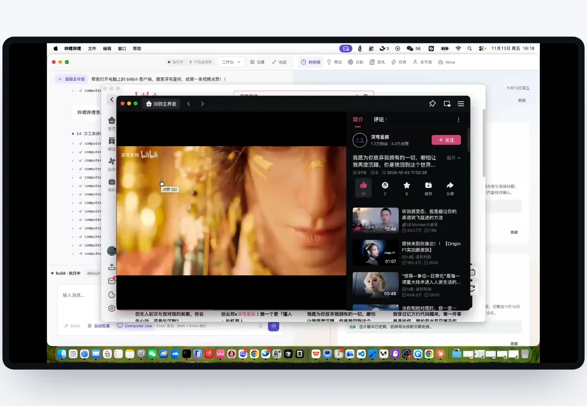
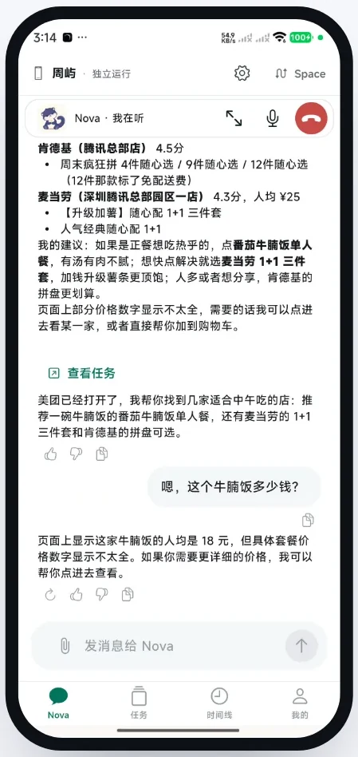
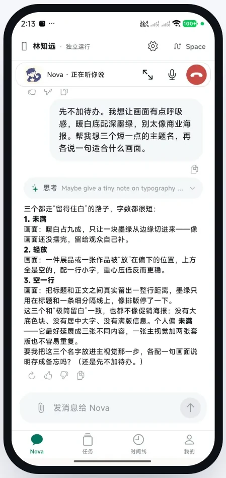

<!-- Keep in sync with README.zh-CN.md -->

<div align="center">


<a href="README.md"><ins>English</ins></a> | <a href="README.zh-CN.md"><ins>简体中文</ins></a>

[](https://github.com/deepnovacore/NovaPersonalAgent/actions/workflows/ci.yml)
[](LICENSE)
[](https://github.com/deepnovacore/NovaPersonalAgent/releases/latest)
[](package.json)
[](https://npm-stat.com/charts.html?package=nova-personal-agent)
[](https://deepnovacore.github.io/NovaPersonalAgent/)
[](https://youtu.be/3qyZupBgOEs)

**Nova Personal Agent (NPA) is a voice-first and local-first open-source personal agent. It talks while it works, understands you over time, runs locally and freely (mobile-native and pc-native, no cloud computer required).**


Nova thinks ahead before you ask, keeps talking while it works, picks up on your phone where your computer left off, and gets to know you better with every conversation. It remembers you, understands the moment, then acts for you on any device. 

**[Website](https://deepnovacore.github.io/NovaPersonalAgent/) · [Documentation](docs/en/README.md) · [Product film](https://youtu.be/3qyZupBgOEs)**

[Quickstart](#3-quickstart) · [Highlights](#1-highlights) · [Gallery](#22-gallery) · [macOS](https://github.com/deepnovacore/NovaPersonalAgent/releases/download/v1.0.1/nova-personal-agent-1.0.1-macos-arm64.dmg) | [Android](https://github.com/deepnovacore/NovaPersonalAgent/releases/download/v1.0.1/nova-personal-agent-1.0.1-android-arm64.apk) | [iOS](https://testflight.apple.com/join/eQrtvXYJ)

</div>

---

https://github.com/user-attachments/assets/3a4bfcee-dcb4-4b12-b03c-cdb0133bffa0

<sub>Product film, recorded on persona accounts. More stills in the [gallery](#22-gallery); clips on the [website](https://deepnovacore.github.io/NovaPersonalAgent/#gallery).</sub>

## News

- **2026-11 · [v1.0.1](https://github.com/deepnovacore/NovaPersonalAgent/releases/tag/v1.0.1)** — Client Space realtime voice through the Host, executor approvals and dictation on phones, English Client Space, the `nova-personal-agent` data identity with an optional `npa migrate-data`, and many reliability fixes. [Release notes](docs/releases/v1.0.1.md).
- **2026-11 · [v1.0.0](https://github.com/deepnovacore/NovaPersonalAgent/releases/tag/v1.0.0)** — **Talks while it works, understands you over time, stays on your devices:** Space / Host / Client with end-to-end encrypted sync, a unified iOS and Android companion, a rebuilt Workbench, more executors (coding, computer use, supervised mobile use). [Release notes](docs/releases/v1.0.0.md).
- **2026-10-13 · [v0.4.0](https://github.com/deepnovacore/NovaPersonalAgent/releases/tag/v0.4.0)** — **Continuous context, ongoing work:** GUI-use across browser, computer and phone (experimental), Scheduled Agent Tasks, and a full Timeline for context, evidence and task results.
- **2026-10-07 · [v0.3.0](https://github.com/deepnovacore/NovaPersonalAgent/releases/tag/v0.3.0)** — **Your personal agent:** Todos, Ideas, Goals, Feeds and Profile, with source-backed memory and evidence-checked tasks.
- **2026-09-21 · [v0.2.0](https://github.com/deepnovacore/NovaPersonalAgent/releases/tag/v0.2.0)** — **Voice, your way:** configurable ASR / LLM / TTS, personal memory, MCP and an iPhone companion.
- **2026-08-31 · [v0.1.0](https://github.com/deepnovacore/NovaPersonalAgent/releases/tag/v0.1.0)** — **Always-on voice assistant with dual brains:** responsive frontend conversation and background agent execution, with live steering.

<details>
<summary>Earlier minor releases</summary>

- **2026-10-09 · [v0.3.1](https://github.com/deepnovacore/NovaPersonalAgent/releases/tag/v0.3.1)** — **A smoother start:** ready-to-use text chat and easier desktop upgrades.
- **2026-09-24 · [v0.2.3](https://github.com/deepnovacore/NovaPersonalAgent/releases/tag/v0.2.3)** — Guided first run with one DashScope API key.
- **2026-09-21 · [v0.2.2](https://github.com/deepnovacore/NovaPersonalAgent/releases/tag/v0.2.2)** — Ubuntu desktop and a headless server with QR pairing.

</details>

## 1. Highlights

<picture>
  <source media="(prefers-color-scheme: dark)" srcset="assets/architecture/nova-overview.en.dark.svg">
  
</picture>

Your context informs the conversation; the front brain coordinates work with the back brain. Nova checks results and speaks when it matters.

- **Proactive.** Nova chooses what matters and when to speak, and drafts instead of sending.
- **Memory.** A source-backed Timeline and Profile grow as you talk; every memory can be traced, edited or forgotten.
- **Voice-first.** Full-duplex voice: a front brain that talks and a back brain that works.
- **Local-first.** Your Space lives on a Host you control; devices sync through an end-to-end encrypted relay, either self-hosted or set up automatically over your Tailscale network. Voice can stay local too: one Docker command runs ASR, LLM and TTS on your Mac ([guide](docs/en/deployment/mac-local-voice.md)).

[How Nova works](docs/en/architecture.md) · [Task controls](docs/en/tasks.md) · [Executors](docs/en/executors/overview.md) · [Source permissions](docs/en/sources-and-connectors.md)

## 2. Work with Nova

### 2.1 What Nova does

- **Works your computer.** Searches, opens and likes a video, or builds and tests code, with approvals you control. You can stop it at any point.
- **Works your phone.** Browses apps on a virtual screen under supervision. It browses; it does not order.
- **Chats while it works.** Hand over a task and keep talking. Describe a website by voice, or ask it to read a paper and return a document.
- **Learns you over time.** A Timeline and Profile that grow as you talk, with sources on every answer and controls to edit or forget.
- **Speaks up first.** Tells you when something deserves attention and drafts a reply. It never sends without you.
- **Moves across devices.** Start on the Mac and see the result on your iPhone through your own Space.

### 2.2 Gallery

Real recordings on persona accounts. Clips and the film are on the [website gallery](https://deepnovacore.github.io/NovaPersonalAgent/#gallery).

<table>
  <tr>
    <td width="33%" valign="top"><a href="assets/gallery/stills/pc-computer-use.webp"></a><br><b>Works your computer</b><br>Searches a video and likes it, in plain view.</td>
    <td width="33%" valign="top"><a href="assets/gallery/stills/pc-timeline-cited.webp"></a><br><b>Learns you over time</b><br>Answers come with sources.</td>
    <td width="33%" valign="top"><a href="assets/gallery/stills/pc-draft-unsent.webp"></a><br><b>Drafts, never sends</b><br>The reply lands in Drafts. Sending is your call.</td>
  </tr>
  <tr>
    <td width="33%" valign="top" align="center"><a href="assets/gallery/stills/phone-mobile-result.webp"></a><br><b>Works your phone</b><br>Browses on a virtual screen. Nothing is ordered without you.</td>
    <td width="33%" valign="top" align="center"><a href="assets/gallery/stills/phone-voice-site.webp"></a><br><b>Chat while it works</b><br>Describe a site by voice; keep talking while it builds.</td>
    <td width="33%" valign="top" align="center"><a href="assets/gallery/stills/iphone-feed.webp"></a><br><b>Proactive</b><br>Only what is worth a nudge.</td>
  </tr>
</table>

## 3. Quickstart

### 3.1 Install and run

**v1.0.1 downloads** — [Release notes and SHA-256 checksums](https://github.com/deepnovacore/NovaPersonalAgent/releases/tag/v1.0.1) · [All releases](https://github.com/deepnovacore/NovaPersonalAgent/releases/latest)

| Platform | Download |
| --- | --- |
| macOS · Apple Silicon (arm64) | [DMG (unsigned)](https://github.com/deepnovacore/NovaPersonalAgent/releases/download/v1.0.1/nova-personal-agent-1.0.1-macos-arm64.dmg) |
| Windows · x64 | [EXE (unsigned)](https://github.com/deepnovacore/NovaPersonalAgent/releases/download/v1.0.1/nova-personal-agent-1.0.1-windows-x64.exe) |
| Linux · x64 (Ubuntu 22.04+) | [AppImage](https://github.com/deepnovacore/NovaPersonalAgent/releases/download/v1.0.1/nova-personal-agent-1.0.1-linux-x64.AppImage) · [deb](https://github.com/deepnovacore/NovaPersonalAgent/releases/download/v1.0.1/nova-personal-agent-1.0.1-linux-x64.deb) (unsigned) |
| iOS · NovaCore | [TestFlight](https://testflight.apple.com/join/eQrtvXYJ) |
| Android · arm64 · NovaCore | [APK](https://github.com/deepnovacore/NovaPersonalAgent/releases/download/v1.0.1/nova-personal-agent-1.0.1-android-arm64.apk) |

**Or install the CLI with npm** (1.0.1; Node.js 22.13+). The command is `npa`; `novapersonal` still works:

```bash
npm install --global nova-personal-agent@latest
# open the shipped app; configure a provider to enable voice
npa
# open the settings panel in the app
npa config
# list the keys your voice pipeline needs; --online tests them
npa doctor
```

For coding tasks, install and sign in to the coding agent you choose (Codex by default). Only the selected agent is required; Codex is needed only for the Codex backend.

**Upgrading.** Quit Nova and rerun the install command; settings and data carry over. New installs keep data in `~/.nova-personal-agent`; an existing `~/.nova-audio-agent` stays in use, and moving it with `npa migrate-data [--dry-run]` is optional ([details](docs/en/configuration.md#local-data-location)). Pin a version with `nova-personal-agent@1.0.1`. State files are versioned, so an older build may refuse a newer file: back up, then run `npa reset-state` before downgrading.

**Set up your Space.** A Host (your desktop or a headless server) keeps the runtime, keys and memory. Clients (another desktop, iOS, Android) reach it through an end-to-end encrypted relay: self-hosted, or created automatically by the desktop and exposed over Tailscale Serve (both devices must be on the same Tailscale network). The relay only forwards ciphertext. A standalone Space runs locally with no relay. See the [Space setup guide](docs/en/space-host-client.md) and the [relay guide](relay/README.md).

> Clients need their Host online to chat and never take over background work. Losing the Host loses the Space, and switching modes creates a new Space without migrating data. Upgrading from v0.4? Read the [upgrade notes](docs/releases/v1.0.0.md).

### 3.2 Develop from source

For development from source:

```bash
git clone https://github.com/deepnovacore/NovaPersonalAgent.git nova-personal-agent
cd nova-personal-agent
npm ci && cp .env.example .env
```

Get an API key from [DashScope](https://platform.qianwenai.com) and set `DASHSCOPE_API_KEY`. That one key runs voice, memory and web search. Search goes through Bailian until you add a [Tavily](https://docs.tavily.com) `TAVILY_API_KEY`.

```bash
npm run start:client
# Open Workbench for this launch, overriding the saved startup preference
npm run start:workbench
# Build, diagnose or run the local demos
npm run build --workspace @nova-personal-agent/runtime
node runtime/dist/src/cli.js diagnose --json
node runtime/dist/src/cli.js demo all
```

The client includes microphone, sound, settings and external MCP controls.

### 3.3 Support matrix

| Platform | Desktop app (Host or standalone) | Headless server | Mobile Client |
|---|---|---|---|
| macOS arm64 | ✅ Native echo cancellation | ✅ From source | Pairs to a Host via relay, or runs standalone |
| Windows x64 | ✅ | ❌ | Pairs to a Host via relay, or runs standalone |
| Ubuntu 22.04+ x64 | ✅ | ✅ npm package | Pairs to a Host via relay, or runs standalone |

| Layer | Providers |
|---|---|
| Integrated voice | Qwen realtime, OpenAI realtime, Gemini Live, StepFun (preview) |
| Cascaded ASR / TTS | Volcengine Speech, Gemini, self-hosted (reference: Whisper / Breeze); [Mac local stack (Docker)](docs/en/deployment/mac-local-voice.md) |
| Cascaded LLM | DeepSeek, Qwen / DashScope, Volcengine Ark, OpenAI, Gemini, self-hosted |
| Vision | Qwen-VL family, Doubao Seed |
| Coding agent | Codex, OpenCode, CodeBuddy, Pi, DeepSeek Harness |
| Sources | Local folders, Google via Composio, Apple Mail and Calendar (macOS), Feishu |

Models, credentials and per-provider limits: [support matrix](docs/en/support-matrix.md).

## 4. Documentation

| Read this | For |
|---|---|
| [Documentation home](docs/en/README.md) | The full documentation map |
| [Getting started](docs/en/getting-started.md) | Install, credentials and running from source |
| [Space / Host / Client](docs/en/space-host-client.md) · [Relay](relay/README.md) · [NovaCore mobile](docs/en/iphone.md) | Pairing devices and running a Host |
| [Workbench](docs/en/workbench.md) · [Tasks](docs/en/tasks.md) · [Personal memory](docs/en/personal-memory.md) | The main window, delegated work and memory controls |
| [Executors](docs/en/executors/overview.md) · [Coding agents](docs/en/executors/coding.md) · [Sources and connectors](docs/en/sources-and-connectors.md) | What Nova can do and what it may read |
| [Support matrix](docs/en/support-matrix.md) · [Settings](docs/en/settings.md) | Providers, models and configuration |
| [Architecture](docs/en/architecture.md) · [Security and privacy](docs/en/security.md) · [Glossary](docs/en/glossary.md) | How Nova works and what it guarantees |
| [When should a voice agent speak?](docs/en/blog/2026-08-proactive-voice-agent-design-space.md) | Voice interaction design |

## 5. Roadmap

- [x] **v0.4.0 — Ongoing context and specialist agents.** Persistent home and Timeline, scheduled tasks, incremental Profile updates and multiple coding backends. GUI/device execution remains experimental.
- [x] **v1.0.0 — Voice-first, local-first.** Space / Host / Client, a unified mobile companion, the rebuilt Workbench, more executors and an auditable memory ledger.
- [ ] **Next.** Broader platform acceptance (Windows, Linux and Android recordings), the local voice stack beyond macOS, and deeper mobile use.

Development integrations are not release guarantees. Features ship after their supported configurations pass acceptance.

## 6. Contribution

```bash
npm ci && npm run check && npm run build && npm test
```

Live integrations are credential- and hardware-dependent and never substitute for the
deterministic tests. Security reports: [SECURITY.md](SECURITY.md); contribution rules and
invariants: [CONTRIBUTING.md](CONTRIBUTING.md).

## 7. License

Copyright 2026 DeepNovaCore, [GNU GPL v3 or later](LICENSE).

## 8. Acknowledgements

Nova builds on open-source work including OpenMinis (GPL-3.0) and Mika (Apache-2.0). See [LICENSES](LICENSES) for third-party notices.
