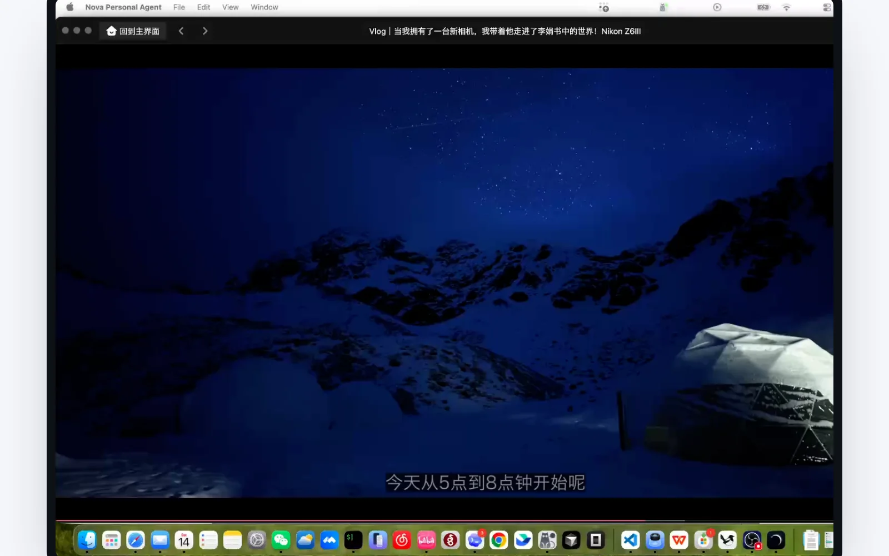
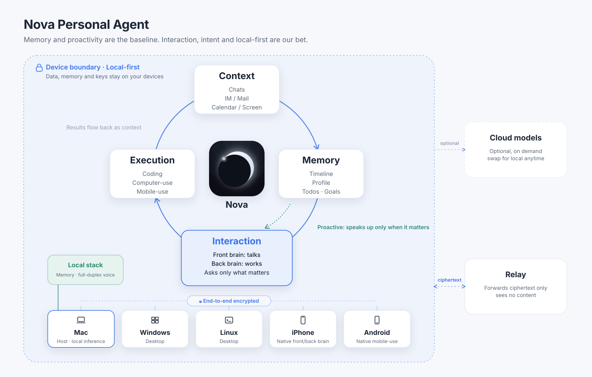
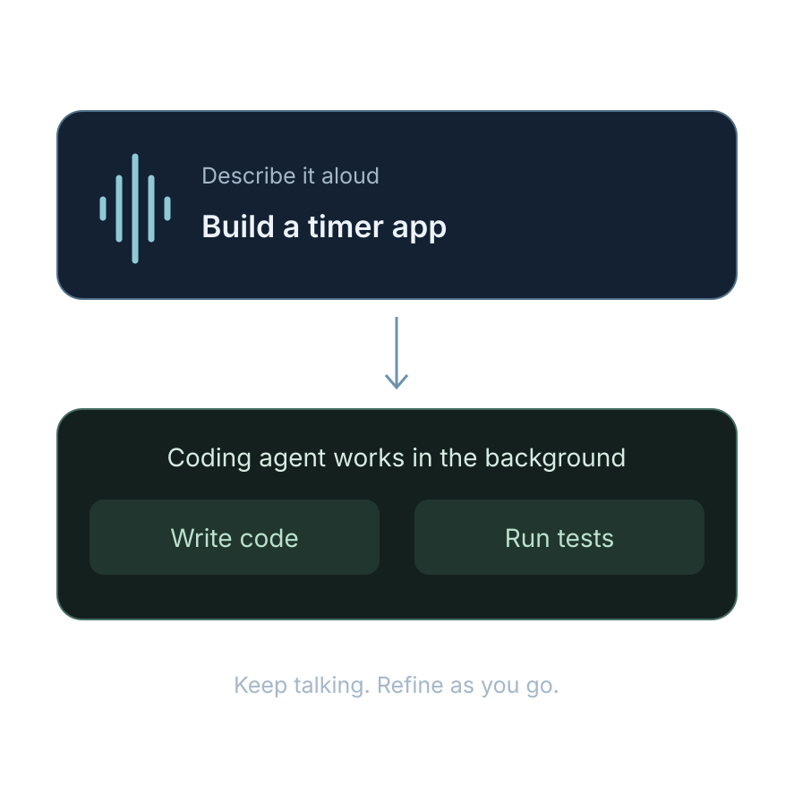
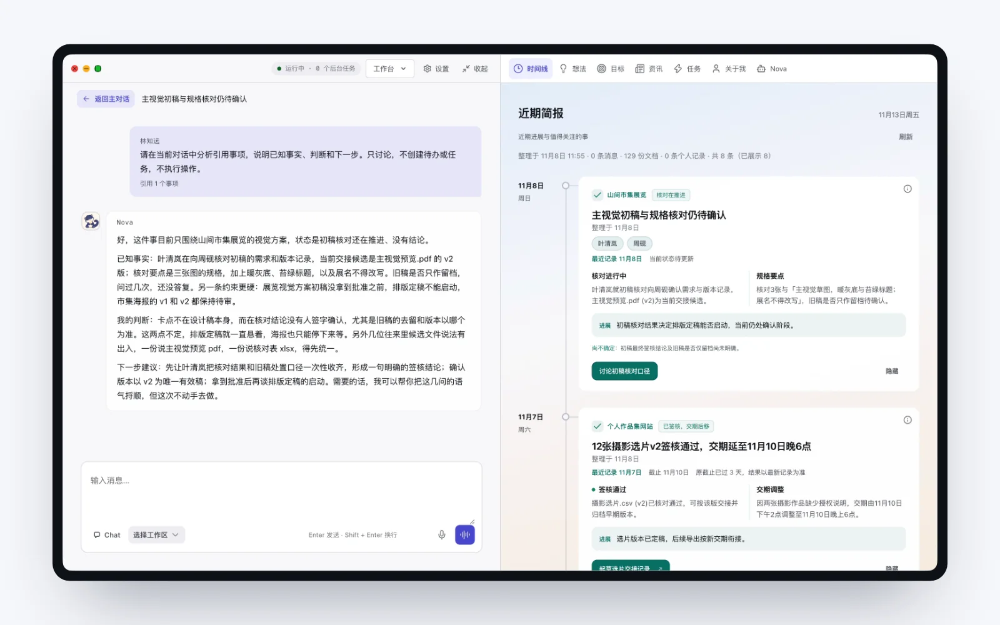
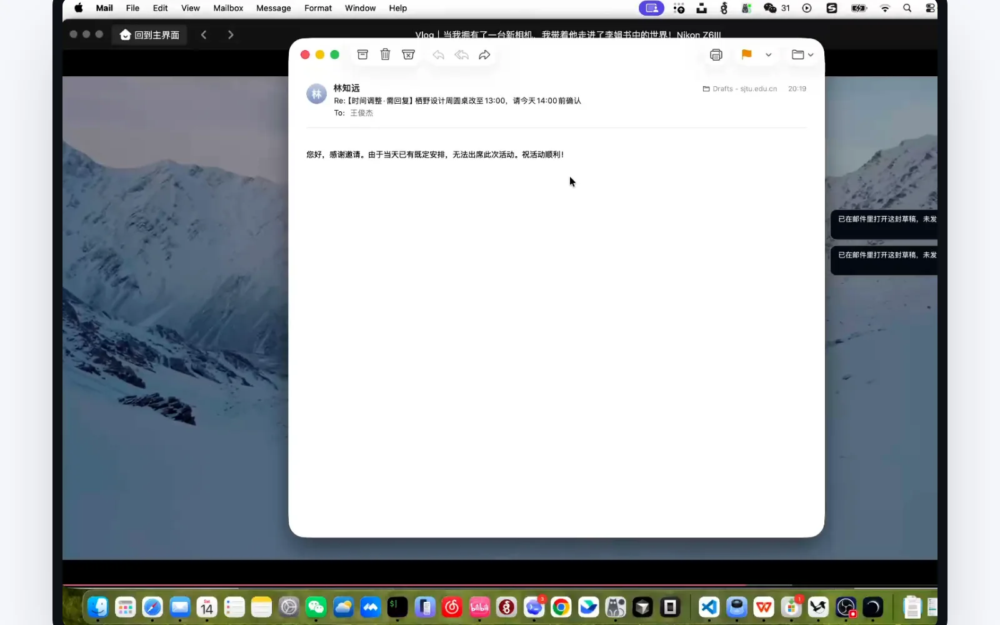
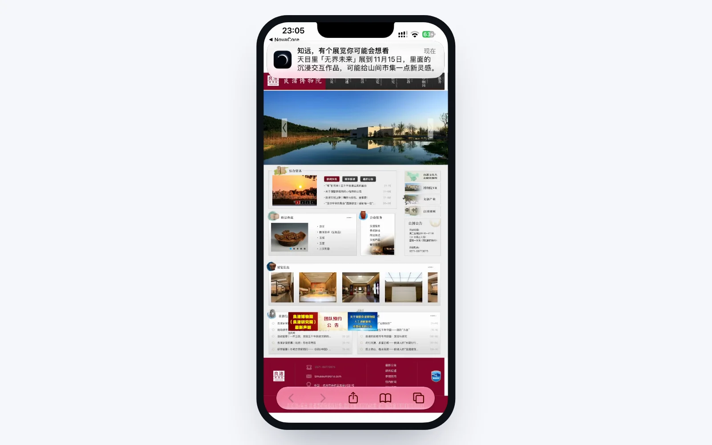

<!-- Keep in sync with README.zh-CN.md -->

<div align="center">

<picture>
  <source media="(prefers-color-scheme: dark)" srcset="assets/brand/npa-header-dark.svg">
  
</picture>

<a href="README.md"><ins>English</ins></a> | <a href="README.zh-CN.md"><ins>简体中文</ins></a>

[](https://github.com/deepnovacore/NovaPersonalAgent/actions/workflows/ci.yml)
[](LICENSE)
[](https://github.com/deepnovacore/NovaPersonalAgent/releases/latest)
[](package.json)
[](https://npm-stat.com/charts.html?package=nova-personal-agent)
[](https://deepnovacore.github.io/NovaPersonalAgent/)
[](https://deepnovacore.github.io/NovaPersonalAgent/#film)

**Nova Personal Agent (NPA) is a voice-first, open-source personal agent. It talks while it works, understands you over time, and keeps your data on your devices.**

The desktop app is **Nova Personal Agent (NPA)**; the Android and iOS apps are **NovaCore**.

Nova draws on your context and private memory to understand what matters to you. It knows how and when to clarify, ask for approval, and move work forward. Its dual brains keep the conversation responsive while background agents handle longer tasks. Refine your goals as work progresses, revisit the results, and stay in control.

**[Website](https://deepnovacore.github.io/NovaPersonalAgent/) · [Documentation](docs/en/README.md) · [Product film](https://deepnovacore.github.io/NovaPersonalAgent/#film)**

[Quickstart](#3-quickstart) · [Highlights](#1-highlights) · [Use cases](#23-use-cases) · [Gallery](#24-gallery) · [Roadmap](#5-roadmap)

</div>

---

[](https://deepnovacore.github.io/NovaPersonalAgent/#gallery)

<sub>Real recording, persona account. Browse the [gallery and clips](#24-gallery) or watch [the film](https://deepnovacore.github.io/NovaPersonalAgent/#film).</sub>

## News

- **2026-11 · [v1.0.0](https://github.com/deepnovacore/NovaPersonalAgent/releases/tag/v1.0.0)** — **Talks while it works, understands you over time, stays on your devices:** Space / Host / Client with end-to-end encrypted sync, a unified iOS and Android companion, a rebuilt Workbench, more executors (coding, computer use, supervised mobile use) and an auditable memory ledger. [Release notes](docs/releases/v1.0.0.md).
- **2026-10-13 · [v0.4.0](https://github.com/deepnovacore/NovaPersonalAgent/releases/tag/v0.4.0)** — **Continuous context, ongoing work:** GUI-use across browser, computer and phone (experimental), Scheduled Agent Tasks, and a full Timeline for context, evidence and task results.
- **2026-10-07 · [v0.3.0](https://github.com/deepnovacore/NovaPersonalAgent/releases/tag/v0.3.0)** — **Your personal agent:** Todos, Ideas, Goals, Feeds and Profile, with source-backed memory and evidence-checked tasks.
- **2026-09-21 · [v0.2.0](https://github.com/deepnovacore/NovaPersonalAgent/releases/tag/v0.2.0)** — **Voice, your way:** configurable ASR / LLM / TTS, personal memory, MCP and an iPhone companion.
- **2026-08-31 · [v0.1.0](https://github.com/deepnovacore/NovaPersonalAgent/releases/tag/v0.1.0)** — **Always-on voice assistant with dual brains:** responsive frontend conversation and background agent execution, with live steering.

<details>
<summary>Earlier minor releases</summary>

- **2026-10-09 · [v0.3.1](https://github.com/deepnovacore/NovaPersonalAgent/releases/tag/v0.3.1)** — **A smoother start:** ready-to-use text chat and easier desktop upgrades.
- **2026-09-24 · [v0.2.3](https://github.com/deepnovacore/NovaPersonalAgent/releases/tag/v0.2.3)** — Guided first run with one DashScope API key.
- **2026-09-21 · [v0.2.2](https://github.com/deepnovacore/NovaPersonalAgent/releases/tag/v0.2.2)** — Ubuntu desktop and a headless server with QR pairing.

</details>

## 1. Highlights

<picture>
  <source media="(prefers-color-scheme: dark)" srcset="assets/architecture/nova-overview.en.dark.svg">
  
</picture>

Your context informs the conversation; the front brain coordinates work with the back brain. Nova checks results and speaks when it matters.

- **Proactive.** Nova chooses what matters and when to speak, and drafts instead of sending.
- **Memory.** A source-backed Timeline and Profile grow as you talk; every memory can be traced, edited or forgotten.
- **Interactive.** Keep talking while work runs in the background.
- **Voice-first.** Full-duplex voice: a front brain that talks and a back brain that works.
- **Local-first.** Your Space lives on a Host you control; devices sync through an end-to-end encrypted relay or Tailscale.

Also in v1.0.0:

- **Your proactive personal agent.** Timeline, Ideas, Goals, Feeds and Profile turn what Nova knows about you into suggestions you can act on.
- **Wide and unstructured context.** Bring folders, mail, calendars, conversations and documents; keep personal memory traceable, editable and removable.
- **Always-on voice assistant with dual brains.** The front brain stays in conversation while the back brain handles long-running work.
- **A thin frontend task coordinator.** Clarify, authorize and delegate to a coding agent; check evidence against your criteria, take over and hand control back.
- **Restrained proactivity.** Nova chooses what matters and when to speak. Routine updates stay quiet, and reminders respect your turn.

- **More executors.** Coding agents, computer use and supervised mobile use share approvals, cancellation and evidence checks. See [Executors](docs/en/executors/overview.md).
- **More coding agents.** New sessions can also run on OpenCode, CodeBuddy, Pi or DeepSeek Harness over ACP; each session keeps the agent it started with. Live steering stays a Codex feature. See [Coding](docs/en/executors/coding.md).

[How Nova works](docs/en/architecture.md) · [Task controls](docs/en/tasks.md) · [Source permissions](docs/en/sources-and-connectors.md)

## 2. Work with Nova

### 2.1 Your personal agent, with wide and unstructured context

Connect the sources you choose: folders, mail, calendars and conversations. Personal memory and imported document knowledge help Nova understand your work; reading sources and model processing remain separate permissions.

<table>
  <tr>
    <td width="50%" valign="top">
      <h3>Your personal workbench</h3>
      <p>Turn scattered context into source-backed suggestions for ideas and goals. Choose what to do next, then continue with Nova.</p>
      <a href="assets/features/workbench-original.en.png"></a>
    </td>
    <td width="50%" valign="top">
      <h3>Profile and personal memory</h3>
      <p>Nova builds an editable picture of your work and interests. Trace personal memories to their sources, correct them or remove them.</p>
      <a href="assets/features/profile-original.en.png"></a>
    </td>
  </tr>
  <tr>
    <td width="50%" valign="top">
      <h3>Ideas and goals</h3>
      <p>Keep an idea, choose a direction, and turn it into a goal when you are ready. Suggestions wait for you to adopt them.</p>
      <a href="assets/features/ideas-goals-original.en.png"></a>
    </td>
    <td width="50%" valign="top">
      <h3>Feeds that follow your interests</h3>
      <p>Review public news ranked by your Profile. Save a story or turn it into an idea, todo or goal.</p>
      <a href="assets/features/feeds-original.en.png"></a>
    </td>
  </tr>
</table>

### 2.2 Your voice assistant with restrained proactivity

The front brain handles conversation; the back brain does the work. Task events and camera observations inform optional updates, while speaking has its own timing.

<table>
  <tr>
    <td width="50%" valign="top">
      <h3>Understands what you mean</h3>
      <p>Describe your goal naturally. Nova asks for missing details before starting a task; keep talking and refining it while the back brain works.</p>
      <a href="assets/features/conversation-polished.en.png"></a>
    </td>
    <td width="50%" valign="top">
      <h3>You set the boundaries</h3>
      <p>Nova coordinates tasks and checks results against your criteria. Review permissions, take over when needed, and hear updates when they matter.</p>
      <a href="assets/features/permission-polished.en.png"></a>
    </td>
  </tr>
  <tr>
    <td width="50%" valign="top">
      <h3>Voice-run workspaces</h3>
      <p>Create and switch workspaces and sessions by voice. A new workspace waits for your confirmation.</p>
      <a href="assets/features/workspace-polished.en.png"></a>
    </td>
    <td width="50%" valign="top">
      <h3>Bring your tools and knowledge</h3>
      <p>Configure ASR / LLM / TTS and MCP; ask questions across your documents.</p>
      <a href="assets/features/knowledge-polished.en.png"></a>
    </td>
  </tr>
</table>

### 2.3 Use cases

<table>
  <tr>
    <td width="50%" valign="top">
      <h3>Voice Vibe Coding</h3>
      <p>Describe what you want, let a coding agent build and test it, and refine the work through conversation.</p>
      <a href="assets/features/coding.en.svg"></a>
    </td>
    <td width="50%" valign="top">
      <h3>Camera Monitoring</h3>
      <p>Ask Nova to watch for a condition and tell you when it happens. Observation runs independently of coding tasks.</p>
      <a href="assets/features/vision-camera.png"></a>
    </td>
  </tr>
  <tr>
    <td width="50%" valign="top">
      <h3>Weekly Report</h3>
      <p>Ask Nova to recall recent work and help organize a weekly report. Watch the original phone demo.</p>
      <a href="assets/demos/weekly-report/weekly-report.mp4"></a>
      <p><a href="assets/demos/weekly-report/weekly-report.mp4">▶ Watch the demo</a></p>
    </td>
    <td width="50%" valign="top">
      <h3>Take Nova with you</h3>
      <p>Create an independent Space, or pair a mobile Client to a desktop Host through an encrypted relay. The Host runs your agent; the Client shows results and sends actions. Host roles stay fixed for each Space.</p>
      <p>Guide: <a href="docs/en/space-host-client.md">Space / Host / Client</a>. Push delivery to a real device requires a signed build.</p>
      <a href="assets/features/iphone.en.png"></a>
    </td>
  </tr>
</table>

### 2.4 Gallery

Real recordings on persona accounts. Clips and the film are on the [website gallery](https://deepnovacore.github.io/NovaPersonalAgent/#gallery).

<table>
  <tr>
    <td width="33%" valign="top"><a href="assets/gallery/stills/pc-computer-use.webp"></a><br><b>Works your computer</b><br>Searches a video and likes it, in plain view.</td>
    <td width="33%" valign="top"><a href="assets/gallery/stills/phone-mobile-result.webp"></a><br><b>Works your phone</b><br>Browses on a virtual screen. Nothing is ordered without you.</td>
    <td width="33%" valign="top"><a href="assets/gallery/stills/phone-voice-site.webp"></a><br><b>Chat while it works</b><br>Describe a site by voice; keep talking while it builds.</td>
  </tr>
  <tr>
    <td width="33%" valign="top"><a href="assets/gallery/stills/pc-timeline-cited.webp"></a><br><b>Learns you over time</b><br>Answers come with sources.</td>
    <td width="33%" valign="top"><a href="assets/gallery/stills/pc-draft-unsent.webp"></a><br><b>Drafts, never sends</b><br>The reply lands in Drafts. Sending is your call.</td>
    <td width="33%" valign="top"><a href="assets/gallery/stills/iphone-feed.webp"></a><br><b>Proactive</b><br>Only what is worth a nudge.</td>
  </tr>
</table>

## 3. Quickstart

### 3.1 Install and run

**Quick downloads · v1.0.0** — [Release notes and SHA-256 checksums](https://github.com/deepnovacore/NovaPersonalAgent/releases/tag/v1.0.0) · [Latest release](https://github.com/deepnovacore/NovaPersonalAgent/releases/latest)

| Platform | Download |
| --- | --- |
| macOS · Apple Silicon (arm64) | [DMG](https://github.com/deepnovacore/NovaPersonalAgent/releases/download/v1.0.0/nova-personal-agent-1.0.0-macos-arm64.dmg) · [ZIP](https://github.com/deepnovacore/NovaPersonalAgent/releases/download/v1.0.0/nova-personal-agent-1.0.0-macos-arm64-app.zip) |
| Windows · x64 | [EXE](https://github.com/deepnovacore/NovaPersonalAgent/releases/download/v1.0.0/nova-personal-agent-1.0.0-windows-x64.exe) · [Portable ZIP](https://github.com/deepnovacore/NovaPersonalAgent/releases/download/v1.0.0/nova-personal-agent-1.0.0-windows-x64-portable.zip) |
| Linux · Ubuntu 22.04+ x64 | [AppImage](https://github.com/deepnovacore/NovaPersonalAgent/releases/download/v1.0.0/nova-personal-agent-1.0.0-linux-x64.AppImage) · [DEB](https://github.com/deepnovacore/NovaPersonalAgent/releases/download/v1.0.0/nova-personal-agent-1.0.0-linux-x64.deb) |

Mobile: <!-- TODO(v1.0.0): fill in the TestFlight invitation and Android APK links before release --> iOS TestFlight and Android APK links are added at release. Requirements: Node.js 22.13+ and npm. For coding tasks, install and authenticate your chosen coding backend; Codex uses its app-server transport.

Install the release with npm.

```bash
npm install --global nova-personal-agent@latest
# open the shipped app; configure a provider to enable voice
novapersonal
# open the settings panel in the app
novapersonal config
# list the keys your voice pipeline needs; --online tests them
novapersonal doctor
```

v0.4 introduces the Nova Personal Agent package names. Published v0.3.x versions retain the old package names and `novaaudio` command. The new package keeps that command alias and reuses existing data and settings. When migrating an existing global install, first run `npm uninstall --global nova-audio-agent nova-audio-agent-server` to avoid command-link collisions; this leaves user data intact.


Quit Nova before upgrading, then rerun the install command above. To pin a version, use `nova-personal-agent@1.0.0`. Upgrades keep your settings and data. State files are versioned, so an older build may refuse a newer file; run `novapersonal reset-state` (after backing up) before downgrading.

Nova uses Space / Host / Client. Configure a desktop Host with the [Space setup guide](docs/en/space-host-client.md) and deploy or select an encrypted [relay](relay/README.md). Runtime and context stay on the Host; the relay forwards ciphertext. A Client needs its Host online for chat and never takes over background work. Independent Spaces run locally without a relay. Host loss means Space loss; changing modes creates a new Space without migrating old data. Coming from v0.4? See the [upgrade notes](docs/releases/v1.0.0.md).

### 3.2 Develop from source

For development from source:

```bash
git clone https://github.com/deepnovacore/NovaPersonalAgent.git nova-personal-agent
cd nova-personal-agent
npm ci && cp .env.example .env
```

Get an API key from [DashScope](https://platform.qianwenai.com) and set `DASHSCOPE_API_KEY`. That one key runs voice, memory, the camera and web search. Search goes through Bailian until you add a [Tavily](https://docs.tavily.com) `TAVILY_API_KEY`.

```bash
npm run start:client
# Open Workbench for this launch, overriding the saved startup preference
npm run start:workbench
# Build, diagnose or run the local demos
npm run build --workspace @nova-personal-agent/runtime
node runtime/dist/src/cli.js diagnose --json
node runtime/dist/src/cli.js demo all
```

The client includes microphone, camera, sound, settings and external MCP controls. Try hovering over the desktop orb for a surprise :)

### 3.3 Support matrix

| Platform | Desktop app (Host or standalone) | Headless server | Mobile Client |
|---|---|---|---|
| macOS arm64 | ✅ Native echo cancellation | ✅ From source | Pairs to a Host via relay, or runs standalone |
| Windows x64 | ✅ | ❌ | Pairs to a Host via relay, or runs standalone |
| Ubuntu 22.04+ x64 | ✅ | ✅ npm package | Pairs to a Host via relay, or runs standalone |

| Layer | Providers |
|---|---|
| Integrated voice | Qwen realtime, OpenAI realtime, Gemini Live, StepFun (preview) |
| Cascaded ASR / TTS | Volcengine Speech, Gemini, self-hosted (reference: Whisper / Breeze) |
| Cascaded LLM | DeepSeek, Qwen / DashScope, Volcengine Ark, OpenAI, Gemini, self-hosted |
| Vision | Qwen-VL family, Doubao Seed |
| Coding agent | Codex, OpenCode, CodeBuddy, Pi, DeepSeek Harness |
| Sources | Local folders, Google via Composio, Apple Mail and Calendar (macOS), Feishu |

Models, credentials and per-provider limits: [support matrix](docs/en/support-matrix.md).

## 4. Documentation

| Read this | For |
|---|---|
| [Architecture](docs/en/architecture.md) | Modules and boundaries |
| [Glossary and invariants](docs/en/glossary.md) | Vocabulary and rules |
| [Getting started](docs/en/getting-started.md) | Setup and integrations |
| [Workbench](docs/en/workbench.md) · [Tasks](docs/en/tasks.md) · [Sources and connectors](docs/en/sources-and-connectors.md) | The main window, delegated work, and what Nova may read |
| [When should a voice agent speak?](docs/en/blog/2026-08-proactive-voice-agent-design-space.md) | Voice interaction design |
| [Node runtime migration archive](https://github.com/deepnovacore/NovaPersonalAgent/tree/20a0812c0acb83b53cbad4b415d637dafff3c7f6/docs/archs/node-runtime-migration) | Migration-era plans in the history of tag `v0.1.0` |

## 5. Roadmap

- [x] **v0.4.0 — Ongoing context and specialist agents.** Persistent home and Timeline, scheduled tasks, incremental Profile updates and multiple coding backends. GUI/device execution remains experimental.
- [x] **v1.0.0 — Voice-first, local-first.** Space / Host / Client, a unified mobile companion, the rebuilt Workbench, more executors and an auditable memory ledger.
- [ ] **Next.** Broader platform acceptance (Windows, Linux and Android recordings), a packaged local voice stack, and deeper mobile use.

Development integrations are not release guarantees. Features ship after their supported configurations pass acceptance.

## 6. Contribution

```bash
npm ci && npm run check && npm run build && npm test
```

Live integrations are credential- and hardware-dependent and never substitute for the
deterministic tests. Security reports: [SECURITY.md](SECURITY.md); contribution rules and
invariants: [CONTRIBUTING.md](CONTRIBUTING.md).

## 7. License

Copyright 2026 DeepNovaCore, [GNU GPL v3 or later](LICENSE).

## 8. Acknowledgements

Nova builds on open-source work including OpenMinis (GPL-3.0) and Mika (Apache-2.0). See [LICENSES](LICENSES) for third-party notices.
