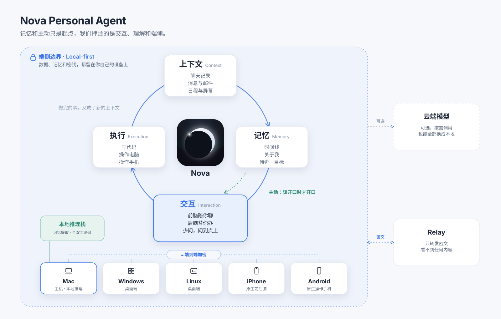
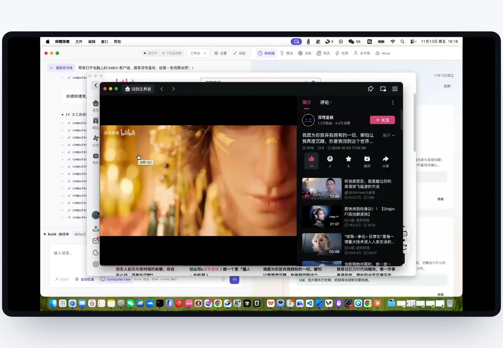
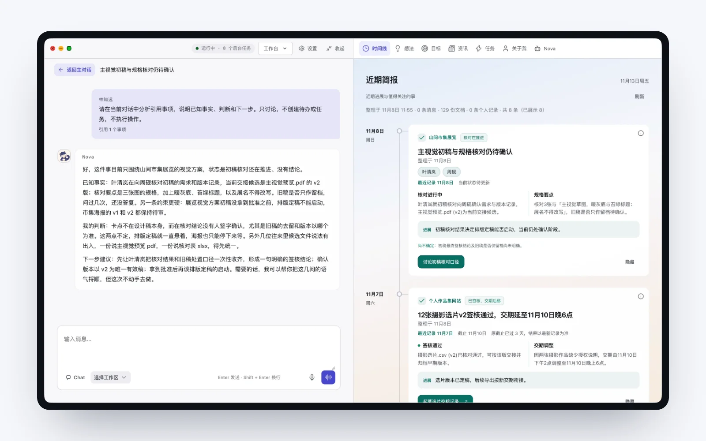
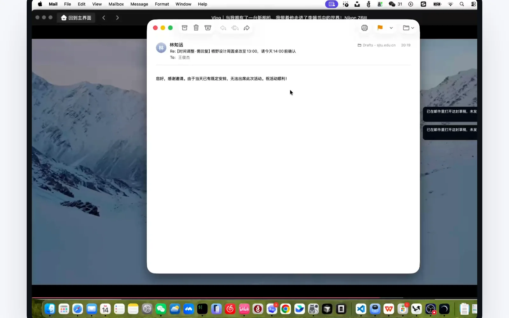
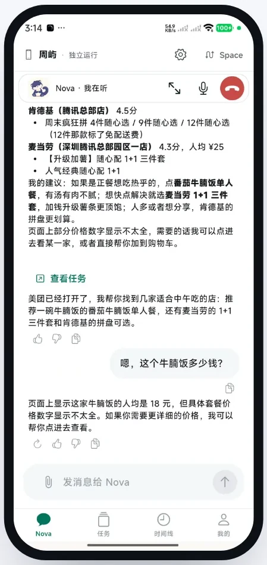
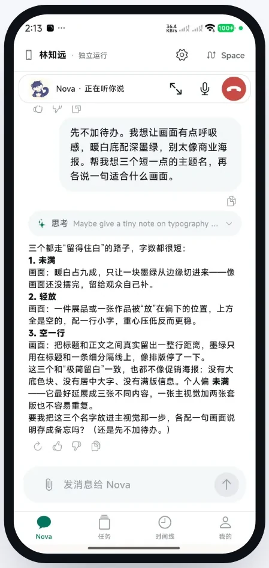

<!-- Keep in sync with README.md -->

<div align="center">


<a href="README.md"><ins>English</ins></a> | <a href="README.zh-CN.md"><ins>简体中文</ins></a>

[](https://github.com/deepnovacore/NovaPersonalAgent/actions/workflows/ci.yml)
[](LICENSE)
[](https://github.com/deepnovacore/NovaPersonalAgent/releases/latest)
[](package.json)
[](https://npm-stat.com/charts.html?package=nova-personal-agent)
[](https://deepnovacore.github.io/NovaPersonalAgent/)
[](https://youtu.be/YHziCK_cKbQ)

**能打电话、边干活边聊天的端侧开源个人助理。越聊越懂你，你的伙伴，你的助手。**


**实时交互**（前后脑架构），边干活边聊天；**端侧闭环**，手机原生执行任务，手机原生快慢脑；多设备通过你自己的 Space 同步（自托管 relay，或基于 Tailscale 自动配置），无需云电脑。多连接器，生成时间线与画像。越聊越懂你，**主动但克制。**

**[官网](https://deepnovacore.github.io/NovaPersonalAgent/) · [文档](docs/zh-CN/README.md) · [宣传片](https://youtu.be/YHziCK_cKbQ)**

[快速开始](#3-快速开始) · [核心特性](#1-核心特性) · [画廊](#22-画廊) · [macOS](https://github.com/deepnovacore/NovaPersonalAgent/releases/download/v1.0.2/nova-personal-agent-1.0.2-macos-arm64.dmg) | [Android](https://github.com/deepnovacore/NovaPersonalAgent/releases/download/v1.0.2/nova-personal-agent-1.0.2-android-arm64.apk) | [iOS](https://testflight.apple.com/join/eQrtvXYJ)

</div>

---

https://github.com/user-attachments/assets/f03208a6-7042-41fc-b12b-4869351703b0


## News

- **2026-11 · [v1.0.2](https://github.com/deepnovacore/NovaPersonalAgent/releases/tag/v1.0.2)** — 手机 Client Space 支持经 Host 的实时语音、执行器审批与听写，Client Space 支持英文界面，数据目录迁到 `nova-personal-agent`（可选 `npa migrate-data`），并修复了大量稳定性问题。[发布说明](docs/releases/v1.0.2.md)。
- **2026-11-19 · [v1.0.0](https://github.com/deepnovacore/NovaPersonalAgent/releases/tag/v1.0.0)** — **端侧原生闭环，边干活边聊天，越聊越懂你：** 支持单设备多空间、手机电脑互联、手机原生任务执行、重写 Workbench、加入更多执行器（coding, computer-use、mobile-use）[发布说明](docs/releases/v1.0.0.md)。
- **2026-10-13 · [v0.4.0](https://github.com/deepnovacore/NovaPersonalAgent/releases/tag/v0.4.0)** — **持续理解，持续行动：** 浏览器、电脑与手机的 GUI-use（实验能力）、定时 Agent 任务，以及保留上下文、证据和任务结果的完整 Timeline。
- **2026-10-07 · [v0.3.0](https://github.com/deepnovacore/NovaPersonalAgent/releases/tag/v0.3.0)** — **你的个人 Agent：** 待办、想法、目标、资讯和 Profile，配合有出处的记忆与按证据核验的任务。
- **2026-09-21 · [v0.2.0](https://github.com/deepnovacore/NovaPersonalAgent/releases/tag/v0.2.0)** — **按你的方式对话：** 可配置 ASR / LLM / TTS、个人记忆、MCP 与 iPhone 客户端。
- **2026-08-31 · [v0.1.0](https://github.com/deepnovacore/NovaPersonalAgent/releases/tag/v0.1.0)** — **常驻语音助手，前后双脑协作：** 前台持续对话，后台 Agent 执行，途中随时补充需求。

<details>
<summary>其他小版本更新</summary>

- **2026-10-09 · [v0.3.1](https://github.com/deepnovacore/NovaPersonalAgent/releases/tag/v0.3.1)** — **上手更顺畅：** 文字对话开箱即用，桌面端升级更省心。
- **2026-09-24 · [v0.2.3](https://github.com/deepnovacore/NovaPersonalAgent/releases/tag/v0.2.3)** — 首次启动引导，一个 DashScope API Key 即可开始对话。
- **2026-09-21 · [v0.2.2](https://github.com/deepnovacore/NovaPersonalAgent/releases/tag/v0.2.2)** — Ubuntu 桌面端与支持扫码配对的无头服务。

</details>

## 1. 核心特性

<picture>
  <source media="(prefers-color-scheme: dark)" srcset="assets/architecture/nova-overview.zh-CN.dark.svg">
  
</picture>

你的上下文帮助 Nova 理解需求，前脑通过对话协调后脑执行。Nova 主动但克制，只在值得开口的时候开口。

- **主动。** Nova 判断什么值得说、何时开口，只起草，不替你发。
- **记忆。** 结构化的个人长期记忆，记得你的偏好，每天写日记，每条记忆都可追溯、编辑或遗忘。
- **语音优先。** 全双工语音：前脑负责说，后脑负责做。
- **本地优先。** 手机原生可跑（事件抽取、任务执行、快慢脑），Space 保存在你掌控的 Host 上，设备通过端到端加密的 relay 同步（自托管，或经 Tailscale 自动配置）。语音管线也能留在本机：一条 Docker 命令在 Mac 上跑起 ASR、LLM 和 TTS（[部署说明](docs/zh-CN/deployment/mac-local-voice.md)）。

[工作原理](docs/zh-CN/architecture.md) · [任务控制](docs/zh-CN/tasks.md) · [执行器](docs/zh-CN/executors/overview.md) · [资料授权](docs/zh-CN/sources-and-connectors.md)

## 2. 和 Nova 一起做事

### 2.1 Nova 能做什么

- **操作你的电脑。** 搜索、打开并点赞一个视频，或者写代码、跑测试，审批由你掌握，随时可以叫停。
- **在手机上办事。** 在虚拟屏幕里，受监督地浏览应用。只浏览，不下单。
- **边干活边聊天。** 交代完任务接着聊。用语音描述一个网站，或者让它读篇论文、交回一份文档。
- **越聊越懂你。** 时间线和个人资料随对话慢慢完整，每个回答都有出处，可以改、可以忘。
- **主动开口。** 有事值得你看，它会告诉你并起草回复，但不会替你发。
- **跨设备接力。** 在 Mac 上交代，在 iPhone 上看结果，数据在你自己的 Space 里。

### 2.2 画廊

更多短片与宣传片见[官网](https://deepnovacore.github.io/NovaPersonalAgent/zh/#gallery)

<table>
  <tr>
    <td width="33%" valign="top"><a href="assets/gallery/stills/pc-computer-use.webp"></a><br><b>操作你的电脑</b><br>搜索视频并点赞，全程可见。</td>
    <td width="33%" valign="top"><a href="assets/gallery/stills/pc-timeline-cited.webp"></a><br><b>越聊越懂你</b><br>回答带着出处。</td>
    <td width="33%" valign="top"><a href="assets/gallery/stills/pc-draft-unsent.webp"></a><br><b>只起草，不替你发</b><br>回复存进草稿箱，发不发由你决定。</td>
  </tr>
  <tr>
    <td width="33%" valign="top" align="center"><a href="assets/gallery/stills/phone-mobile-result.webp"></a><br><b>在手机上办事</b><br>在虚拟屏幕里浏览，不经你同意不下单。</td>
    <td width="33%" valign="top" align="center"><a href="assets/gallery/stills/phone-voice-site.webp"></a><br><b>边干活边聊天</b><br>语音描述网站，边聊边做。</td>
    <td width="33%" valign="top" align="center"><a href="assets/gallery/stills/iphone-feed.webp"></a><br><b>主动</b><br>值得看的才推。</td>
  </tr>
</table>

## 3. 快速开始

### 3.1 安装与启动

**v1.0.2 下载** — [发布说明与 SHA-256 校验文件](https://github.com/deepnovacore/NovaPersonalAgent/releases/tag/v1.0.2) · [全部版本](https://github.com/deepnovacore/NovaPersonalAgent/releases/latest)

| 平台 | 下载 |
| --- | --- |
| macOS · Apple Silicon（arm64） | [DMG（未签名）](https://github.com/deepnovacore/NovaPersonalAgent/releases/download/v1.0.2/nova-personal-agent-1.0.2-macos-arm64.dmg) |
| Windows · x64 | [EXE（未签名）](https://github.com/deepnovacore/NovaPersonalAgent/releases/download/v1.0.2/nova-personal-agent-1.0.2-windows-x64.exe) |
| Linux · x64（Ubuntu 22.04+） | [AppImage](https://github.com/deepnovacore/NovaPersonalAgent/releases/download/v1.0.2/nova-personal-agent-1.0.2-linux-x64.AppImage) · [deb](https://github.com/deepnovacore/NovaPersonalAgent/releases/download/v1.0.2/nova-personal-agent-1.0.2-linux-x64.deb)（未签名） |
| iOS · NovaCore | [TestFlight](https://testflight.apple.com/join/eQrtvXYJ) |
| Android · arm64 · NovaCore | [APK](https://github.com/deepnovacore/NovaPersonalAgent/releases/download/v1.0.2/nova-personal-agent-1.0.2-android-arm64.apk) |

**也可以用 npm 安装命令行版**（1.0.2，需要 Node.js 22.13+）。命令为 `npa`，`novapersonal` 仍可用：

```bash
# 全局安装
npm install --global nova-personal-agent@latest
# 启动客户端；语音功能需在设置中配置服务商
npa
# 打开设置面板
npa config
# 查看当前语音管线需要哪些密钥；加 --online 在线验证
npa doctor
```

编码任务需要先安装并登录你选用的编码 Agent（默认 Codex）。只需安装所选的那一个；只有选用 Codex 后端时才需要 Codex。

**升级与数据目录。** 新安装的数据在 `~/.nova-personal-agent`；已有的 `~/.nova-audio-agent` 会继续沿用，是否用 `npa migrate-data [--dry-run]` 迁移（需先退出 Nova）由你决定，[详情](docs/zh-CN/configuration.md#本地数据位置)。

**配置你的 Space。** Host（你的桌面电脑或无头服务器）保存 runtime、密钥和记忆；Client（另一台电脑、iOS、Android）通过端到端加密的 relay 连接 Host：可自托管，也可由桌面端自动创建并经 Tailscale Serve 暴露（两台设备需登录同一 Tailscale 网络）。relay 只转发密文。独立 Space 在本机运行，无需 relay。详见 [Space 设置指南](docs/zh-CN/space-host-client.md)与 [relay 部署说明](relay/README.md)。

> Client 聊天需要 Host 在线，也不会接管后台任务。Host 丢失即 Space 丢失；切换模式会新建 Space，旧数据不迁移。从 v0.4 升级请先看[升级说明](docs/releases/v1.0.0.md)。

### 3.2 从源码开发

从源码开发时：

```bash
git clone https://github.com/deepnovacore/NovaPersonalAgent.git nova-personal-agent
cd nova-personal-agent
npm ci && cp .env.example .env
# 在 .env 中填入 DASHSCOPE_API_KEY
```

从 [DashScope](https://platform.qianwenai.com) 获取 API Key 并配置 `DASHSCOPE_API_KEY`。这一把密钥就能用语音、记忆和联网搜索；搜索默认走百炼，配置 [Tavily](https://docs.tavily.com) 的 `TAVILY_API_KEY` 后改用 Tavily。

启动桌面应用：
```bash
npm run start:client
# 本次直接打开 Workbench，覆盖已保存的启动偏好
npm run start:workbench
# 构建、诊断或运行本地演示
npm run build --workspace @nova-personal-agent/runtime
node runtime/dist/src/cli.js diagnose --json
node runtime/dist/src/cli.js demo all
```

客户端提供麦克风、声音、设置和外部 MCP 控件。

### 3.3 支持矩阵

| 平台 | 桌面应用（Host 或独立） | 无头服务 | 手机 Client |
|---|---|---|---|
| macOS arm64 | ✅ 原生回声消除 | ✅ 源码运行 | 通过 relay 配对 Host，或独立运行 |
| Windows x64 | ✅ | ❌ | 通过 relay 配对 Host，或独立运行 |
| Ubuntu 22.04+ x64 | ✅ | ✅ npm 包 | 通过 relay 配对 Host，或独立运行 |

| 层 | 可选服务 |
|---|---|
| 集成语音 | Qwen realtime、OpenAI realtime、Gemini Live、StepFun（预览） |
| 级联 ASR / TTS | 火山语音、Gemini、自托管（参考实现：Whisper / Breeze）；[Mac 本地推理栈（Docker）](docs/zh-CN/deployment/mac-local-voice.md) |
| 级联 LLM | DeepSeek、Qwen / DashScope、火山方舟、OpenAI、Gemini、自托管 |
| 视觉 | Qwen-VL 系列、Doubao Seed |
| 编码 Agent | Codex、OpenCode、CodeBuddy、Pi、DeepSeek Harness |
| 数据源 | 本地文件夹、Google（经 Composio）、Apple 邮件与日历（macOS）、飞书 |

各模型、凭据与服务商限制见[支持矩阵](docs/zh-CN/support-matrix.md)。

## 4. 文档

| 读这篇 | 目的 |
|---|---|
| [文档首页](docs/zh-CN/README.md) | 完整文档地图 |
| [上手指南](docs/zh-CN/getting-started.md) | 安装、凭据配置与源码运行 |
| [Space / Host / Client](docs/zh-CN/space-host-client.md) · [Relay](relay/README.md) · [NovaCore 手机端](docs/zh-CN/iphone.md) | 设备配对与 Host 部署 |
| [Workbench](docs/zh-CN/workbench.md) · [任务](docs/zh-CN/tasks.md) · [个人记忆](docs/zh-CN/personal-memory.md) | 主窗口、交办的任务与记忆管理 |
| [执行器](docs/zh-CN/executors/overview.md) · [编码 Agent](docs/zh-CN/executors/coding.md) · [资料来源与连接器](docs/zh-CN/sources-and-connectors.md) | Nova 能做什么、能读取哪些资料 |
| [支持矩阵](docs/zh-CN/support-matrix.md) · [设置](docs/zh-CN/settings.md) | 服务商、模型与配置 |
| [架构](docs/zh-CN/architecture.md) · [安全与隐私](docs/zh-CN/security.md) · [术语表](docs/zh-CN/glossary.md) | 工作原理与系统保证 |
| [语音助手什么时候该开口？](docs/zh-CN/blog/2026-08-proactive-voice-agent-design-space.md) | 语音交互设计 |

## 5. 路线图

- [x] **v0.4.0 — 持续上下文与专长 Agent。** 持续主会话与 Timeline、定时任务、增量画像及多编码后端；GUI/设备执行继续作为实验能力。
- [x] **v1.0.0 — 语音优先，本地优先。** Space / Host / Client、统一的手机伙伴应用、重做的 Workbench、更多执行器与可审计的记忆账本。
- [ ] **下一步。** 扩大平台验收（Windows、Linux、Android 录屏）、把本地语音栈扩展到 macOS 以外，并深化手机操作。

未列入发布说明的接入不等于正式版支持；各项能力完成对应配置的验收后再发布。

## 6. 贡献

```bash
npm ci && npm run check && npm run build && npm test
```

安全问题见 [SECURITY.md](SECURITY.md)，贡献规则见 [CONTRIBUTING.md](CONTRIBUTING.md)。

## 7. 许可证

版权所有 2026 DeepNovaCore，[GNU GPL v3 或更高版本](LICENSE)。

## 8. 致谢

Nova 建立在多个开源项目之上，包括 OpenMinis（GPL-3.0）与 Mika（Apache-2.0）。第三方声明见 [LICENSES](LICENSES)。
