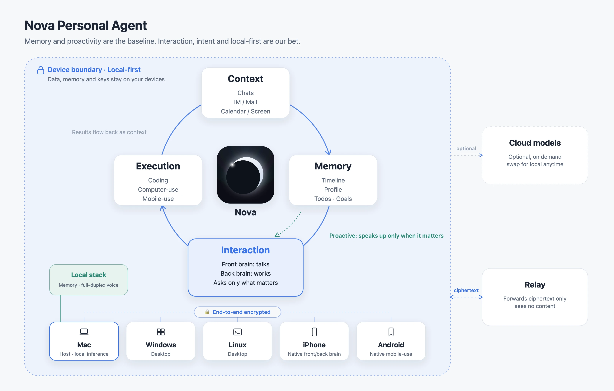
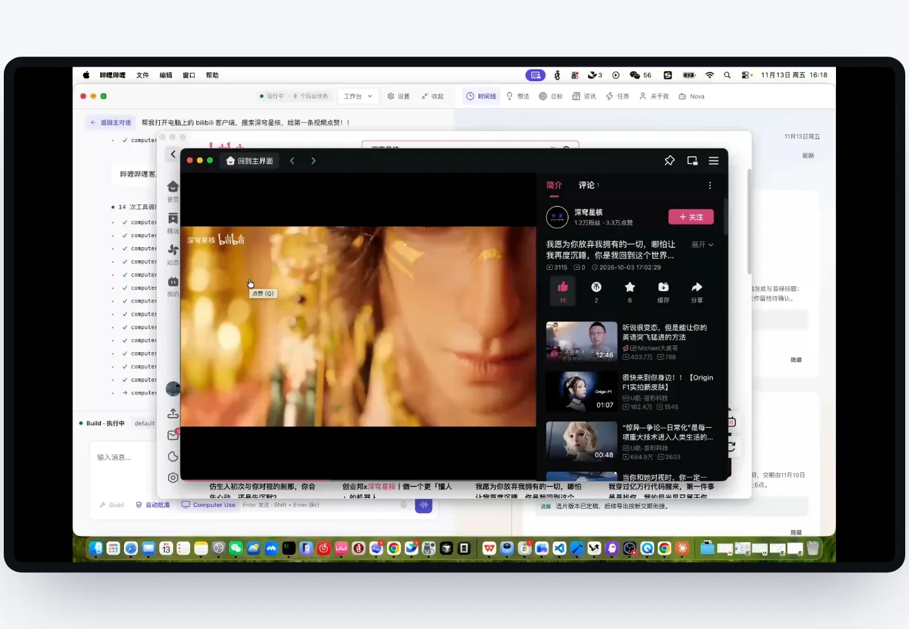
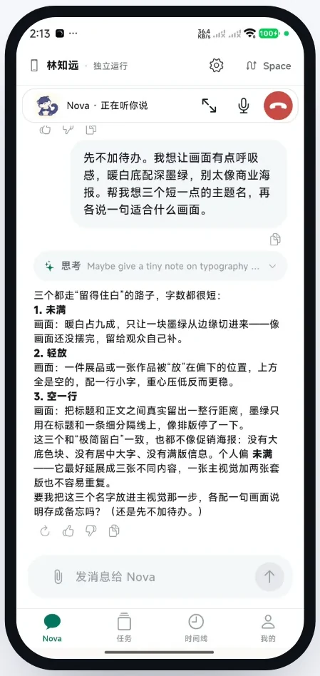

# Nova Personal Agent

**A voice-first, local-first personal agent. It talks while it works, understands you over time, and keeps your data on devices you control.**

[Website](https://deepnovacore.github.io/NovaPersonalAgent/) · [Documentation](https://deepnovacore.github.io/NovaPersonalAgent/en/docs/) · [GitHub](https://github.com/deepnovacore/NovaPersonalAgent) · [简体中文](https://github.com/deepnovacore/NovaPersonalAgent/blob/main/README.zh-CN.md)

```bash
npm install --global nova-personal-agent
npa
```



## Why Nova

- **Talks while it works.** A front brain keeps the full-duplex conversation going while a back brain runs coding, computer-use and supervised mobile tasks.
- **Understands you over time.** A source-backed Timeline and Profile grow as you talk; every memory can be traced, edited or forgotten.
- **Local-first.** Your Space lives on a Host you control. Desktop, iOS and Android sync through an end-to-end encrypted relay or Tailscale.

<table>
  <tr>
    <td width="62%" valign="top"><br><b>Works your computer</b> — in plain view, with approvals you control.</td>
    <td width="38%" valign="top" align="center"><br><b>Chats while it works</b> — describe a site by voice and keep talking.</td>
  </tr>
</table>

## Install

Requires **Node.js 22.13+** on **macOS Apple Silicon**, **Windows x64** or an **Ubuntu 22.04+ x64 desktop**.

```bash
npm install --global nova-personal-agent
npa
```

`npa` downloads the matching desktop app from [GitHub Releases](https://github.com/deepnovacore/NovaPersonalAgent/releases), verifies its SHA-256 digest and launches it — no source checkout or build. Then pick your model and voice providers in Settings. Desktop apps are unsigned, so Gatekeeper or SmartScreen may warn on first launch. Coding tasks also need an installed and signed-in coding agent (Codex by default).

## Commands

| Command | Purpose |
| --- | --- |
| `npa` / `npa start` | Download if needed and launch the desktop app |
| `npa config` | Open desktop settings |
| `npa doctor` | Check platform support, installation and the voice keys your pipeline needs |
| `npa doctor --online` | Also test provider keys set in the environment |
| `npa reset-state` | Move an unreadable state file aside (quit Nova first) |
| `npa migrate-data [--dry-run]` | Optionally move local data from `~/.nova-audio-agent` to `~/.nova-personal-agent` (quit Nova first; `--dry-run` changes nothing) |
| `npa --version` · `npa --help` | Show the release version or help |

`novapersonal` and `novaaudio` remain aliases of `npa`.

## Phones and servers

- **iOS · NovaCore** — [TestFlight](https://testflight.apple.com/join/eQrtvXYJ)
- **Android · NovaCore** — [APK (arm64)](https://github.com/deepnovacore/NovaPersonalAgent/releases/download/v1.0.0/nova-personal-agent-1.0.0-android-arm64.apk)
- **Headless Host** — [nova-personal-agent-server](https://www.npmjs.com/package/nova-personal-agent-server) for Ubuntu servers

## Upgrade

Quit Nova and rerun the install command; settings and data carry over. Pin this release with `nova-personal-agent@1.0.0`, and back up before downgrading — an older build does not roll back data changes. Coming from `nova-audio-agent`? Run `npm uninstall --global nova-audio-agent` first so the command links do not collide; downloads stay under `~/.nova-audio-agent/cli/releases/`.

[Release notes](https://github.com/deepnovacore/NovaPersonalAgent/releases/tag/v1.0.0) · [Report an issue](https://github.com/deepnovacore/NovaPersonalAgent/issues) · [GPL-3.0-or-later](https://github.com/deepnovacore/NovaPersonalAgent/blob/main/LICENSE)
