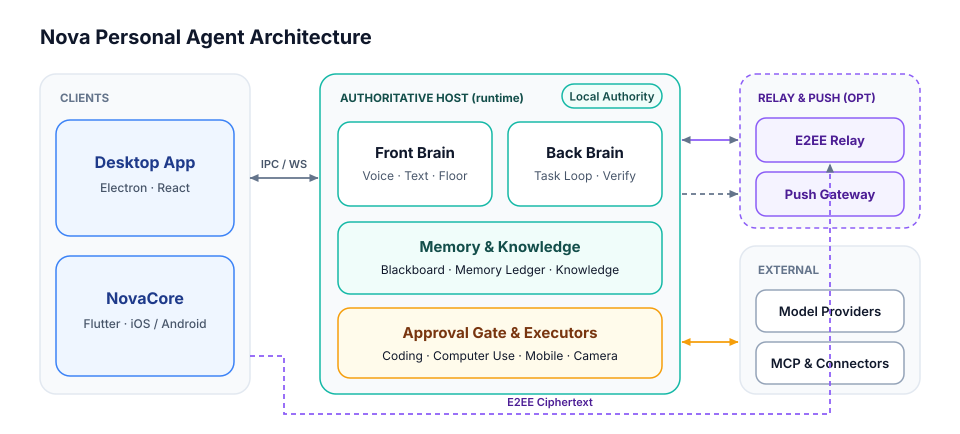

<picture>
  <source media="(prefers-color-scheme: dark)" srcset="../../assets/brand/npa-header-dark.svg">
  
</picture>

<a href="README.md"><ins>English</ins></a> | <a href="../zh-CN/README.md"><ins>简体中文</ins></a> · <a href="../../README.md">Repository Home</a>

**Documentation for Nova Personal Agent (`v1.0.0`)** — dual-brain realtime voice & text interaction, ledger-authoritative personal memory, specialist executors, and end-to-end encrypted Space connectivity across desktop and mobile (**NovaCore**).

[Getting Started](getting-started.md) · [Architecture](architecture.md) · [Support Matrix](support-matrix.md) · [Security & Privacy](security.md) · [v1.0.0 Release Notes](../releases/v1.0.0.md)

---

## Architecture at a Glance

<picture>
  <source media="(prefers-color-scheme: dark)" srcset="../../assets/architecture/system-overview.en.dark.svg">
  
</picture>

- **Dual-Brain Runtime:** The **Front Brain** stays responsive in realtime voice/text while the **Back Brain** orchestrates durable background tasks, evidence checks, and take-over/hand-back controls.
- **Authoritative Local Host:** Model keys, permissions, source connectors, and personal memory stay on your Host (`0700` private storage); retrieved memories never grant execution authority.
- **Specialist Executors:** Delegate coding (`Codex` + `ACP` agents), desktop GUI (`Computer Use`), phone automation (`mobile.run`), and independent `Loop Camera` monitoring under unified host approval gates.
- **E2EE Space Connectivity:** Pair iOS and Android (**NovaCore**) to your desktop or headless Host via Tailscale Serve or a self-hosted zero-knowledge `relay`.

---

## Documentation Map

<table>
  <tr>
    <td width="50%" valign="top">
      <h3>1. Start Here</h3>
      <ul>
        <li><a href="getting-started.md"><strong>Getting Started</strong></a> — Install, configure credentials, and run from source.</li>
        <li><a href="features.md"><strong>Features</strong></a> — Core capabilities, limits, and interaction model.</li>
        <li><a href="support-matrix.md"><strong>Support Matrix</strong></a> — Integrated &amp; cascaded voice pipelines, LLMs, vision, and connectors.</li>
        <li><a href="../releases/v1.0.0.md"><strong>v1.0.0 Release Notes</strong></a> — Highlights and Space upgrade notes (<a href="../releases/v0.4.0.md">v0.4.0</a>).</li>
      </ul>
    </td>
    <td width="50%" valign="top">
      <h3>2. Workbench, Tasks &amp; Memory</h3>
      <ul>
        <li><a href="workbench.md"><strong>Workbench</strong></a> — Timeline, Ideas, Goals, Feeds, Tasks, and Profile.</li>
        <li><a href="tasks.md"><strong>Tasks</strong></a> — Acceptance criteria, evidence verification, take-over &amp; hand-back.</li>
        <li><a href="sources-and-connectors.md"><strong>Sources &amp; Connectors</strong></a> — Local folders, Google, Apple Mail/Calendar, and Feishu.</li>
        <li><a href="personal-memory.md"><strong>Personal Memory</strong></a> — Unified ledger, provenance, forget/purge, and recall engines.</li>
        <li><a href="knowledge-base.md"><strong>Knowledge Base</strong></a> — Opt-in local document search (FTS5 + embeddings).</li>
      </ul>
    </td>
  </tr>
  <tr>
    <td width="50%" valign="top">
      <h3>3. Mobile &amp; Space (iOS / Android)</h3>
      <ul>
        <li><a href="iphone.md"><strong>NovaCore Mobile Guide</strong></a> — Client Space vs. Standalone Space on iOS &amp; Android.</li>
        <li><a href="space-host-client.md"><strong>Space / Host / Client Setup</strong></a> — Pairing, Tailscale auto-setup, headless Host, and recovery rules.</li>
        <li><a href="deployment/remote-server.md"><strong>Remote Server Overview</strong></a> — Headless Host &amp; relay boundary.</li>
        <li><a href="../../relay/README.md"><strong>Self-Hosted Relay</strong></a> — Docker, TLS, and zero-knowledge ciphertext forwarding.</li>
        <li><a href="../../push-gateway/README.md"><strong>Push Gateway</strong></a> — APNs &amp; FCM wakeup delivery.</li>
      </ul>
    </td>
    <td width="50%" valign="top">
      <h3>4. Executors &amp; Automation</h3>
      <ul>
        <li><a href="executors/overview.md"><strong>Executors Overview</strong></a> — Dispatch, resource leases, and approval gates.</li>
        <li><a href="executors/coding.md"><strong>Coding Agents</strong></a> — Codex app-server &amp; ACP (OpenCode, CodeBuddy, Pi, DeepSeek Harness).</li>
        <li><a href="executors/computer-use-build.md"><strong>Computer Use in Build</strong></a> — Supervised desktop GUI actions on macOS &amp; Windows.</li>
        <li><a href="../guides/mobile.md"><strong>Mobile Use (<code>mobile.run</code>)</strong></a> — Native TypeScript Midscene SDK (<a href="../guides/autoglm.md">legacy AutoGLM</a>).</li>
        <li><a href="executors/loop-camera.md"><strong>Loop Camera</strong></a> — Independent camera condition monitoring.</li>
      </ul>
    </td>
  </tr>
  <tr>
    <td width="50%" valign="top">
      <h3>5. Models, Voice &amp; Settings</h3>
      <ul>
        <li><a href="global-providers.md"><strong>OpenAI &amp; Gemini Providers</strong></a> — Realtime &amp; cascaded global model setup.</li>
        <li><a href="deployment/self-hosted-voice.md"><strong>Self-Hosted Voice</strong></a> — Run Whisper ASR, vLLM, and Breeze TTS on your GPU.</li>
        <li><a href="settings.md"><strong>Desktop Settings</strong></a> — Save vs. restart boundaries and UI controls.</li>
        <li><a href="configuration.md"><strong>Core Configuration</strong></a> — Environment variables and capability registry.</li>
      </ul>
    </td>
    <td width="50%" valign="top">
      <h3>6. Architecture, Protocol &amp; Security</h3>
      <ul>
        <li><a href="architecture.md"><strong>How Nova Works</strong></a> — System overview, task loop, and state boundaries.</li>
        <li><a href="security.md"><strong>Security &amp; Privacy Architecture</strong></a> — E2EE boundaries, consent separation, and executor gates.</li>
        <li><a href="glossary.md"><strong>Glossary &amp; Invariants</strong></a> — Shared terminology and system guarantees.</li>
        <li><a href="protocols/client-v1.md"><strong>Client Protocol v1</strong></a> — Remote frames, audio format, and control receipts.</li>
        <li><a href="blog/2026-08-proactive-voice-agent-design-space.md"><strong>Proactive Voice Design</strong></a> — Why and when a voice agent should speak.</li>
      </ul>
    </td>
  </tr>
</table>

---

## Developer Architecture Series

Deep-dive volumes in [`archs/`](archs/00-overview.md):

| # | Volume | Focus |
|---|---|---|
| 01 | [Runtime spine](archs/01-spine.md) | Event loop, dual-brain coordination, and speech ownership |
| 02 | [Memory](archs/02-memory.md) | L0 Blackboard, Unified Ledger, derived recall engines, and knowledge store |
| 03 | [Context view](archs/03-context-view.md) | Prompt assembly, trust labels, and bounded projections |
| 04 | [Ports](archs/04-ports.md) | Model, transport, memory, and tool port contracts |
| 05 | [Executors](archs/05-executors.md) | Executor lifecycle, approvals, progress, and cancellation |
| 06 | [Local development](archs/06-verification.md) | Monorepo build, isolated test runs, and verification |
| 07 | [Design constraints](archs/07-decision-record.md) | Architectural invariants and explicit non-goals |
| 08 | [Conversations, modes &amp; workspaces](archs/08-conversations-modes-workspaces.md) | `Chat` / `Plan` / `Build` / `Delegate` and single-voice ownership |
| 09 | [Roadmap](archs/09-roadmap.md) | Post-v1.0.0 directions |
| 10 | [Executor onboarding](archs/10-executor-onboarding.md) | Adding new specialist executors safely |
| 11 | [Vision](archs/11-vision.md) | Conversation vision vs. independent Loop Camera monitoring |
