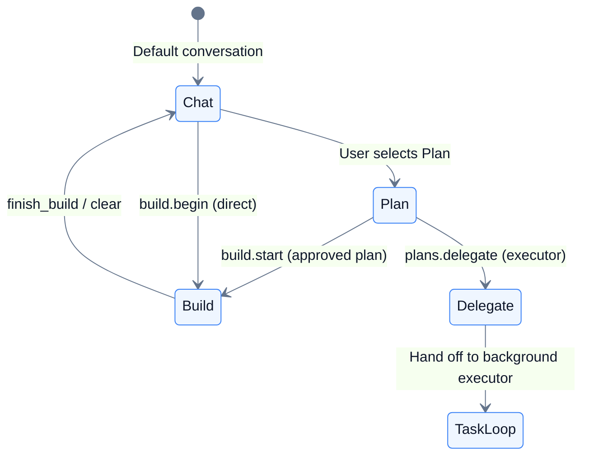

# 8. Conversations, Modes and Workspaces

A **conversation** is the unit you talk to Nova in; a **workspace** is the unit a local Build or a
coding session works inside. This volume explains how the two connect in the desktop host, how the four
Workbench modes route work, and which host state prevents two runs from mutating one directory at the
same time.

## Conversation kinds

`conversations.ts` defines four kinds:

- `chat` — a regular conversation. `chat:main` is created at startup and is the durable main thread;
  Proactive messages are written there with `origin: 'proactive'`.
- `topic` — opened from a feed or card with `conversations.open_feed`. It is idempotent by
  `subject_key`, carries prepared background marked `untrusted_external`, and never grants execution
  authority.
- `schedule` — a hidden run record created for a scheduled task. It cannot be selected (`conversations.select`
  rejects it), cannot own voice, and only a scheduled execution grant may run it.
- `build` — a local Build conversation created by `build.begin` or `build.start`, with its own
  `build` state. Clearing it resets the conversation to `kind: 'chat'`, `mode: 'chat'` and drops the
  build state.

Items also carry `mode` (`chat` or `plan`), an optional `plan` reference, `build`, `coding_target`,
`generation`, messages and prepared content. The client snapshot exposes a bounded projection:
`id`, `kind`, `title`, `last_message`, `generation_status`, `mode`, `plan`, `build`, `coding_target`,
timestamps, `generation` and `unread_count`.

## The conversation pool and voice ownership

`ConversationRuntimePool` (`runtime/src/personal-agent/conversations.ts`) owns one runtime per
conversation and keeps a per-conversation turn tail: turns in the same conversation execute in order,
while different conversations may run concurrently. Each runtime has a mode — `text`, `voice` or
`parked` — and a generation-scoped `AbortController`. `clear()` aborts the runtime, retires a runtime
that still owns tasks (so a cancelled task keeps its record) and invalidates the generation;
`canChangeTarget()` refuses target or mode changes while a turn, voice session or tool run is in
flight.

There is exactly one voice owner for the host, stored as `conversations.voice_id` and enforced by
`conversations.voice`. Starting voice clears that conversation's text runtime and stops any prior
voice session; starting voice on a Build that is currently running is refused with
`conversation_busy` rather than interrupting it. Plan and Build conversations can own voice, but
while they do the model gets no tools: the provider tool view is empty and a tool call is refused with
`workbench_voice_readonly`, which asks you to return to text to confirm execution. A voice turn's
transcript is written back to the same conversation.

## The four modes

The four routes are:

| Mode | What it does | Entry and result |
|---|---|---|
| Chat | Conversation, memory, search and knowledge tools; no task dispatch | Default mode of a regular conversation |
| Plan | Clarifies the goal and publishes a plan; read-only tools plus `publish_plan` | The user selects Plan; the client sends `conversations.mode {mode: 'plan'}` |
| Build | Local ReAct over read, write, exact edit and shell under per-action approval | `build.begin` (direct) or `build.start` (approved plan) |
| Delegate | Hands the approved plan to an executor and follows it through the Task loop | `plans.delegate {executor}` from a Plan conversation |

Chat cannot create, cancel or dispatch tasks, schedule work, or switch modes through a model tool. The user selects the execution mode. Plan has no local file or shell tools and does not dispatch; it
produces a versioned plan, and the user edits it through `plans.edit`. Build runs locally only on
macOS and Windows and stays interactive until it calls `finish_build`, after which the conversation is
locked. Delegate requires the current plan reference, validates that the executor is a configured
Workbench executor, and returns the existing task when the same plan version was already delegated.

## Direct Build, Plan to Build, and Delegate

- **Direct Build** (`build.begin`) skips the plan. The host admits a new `build` conversation,
  canonicalizes the workspace, takes the project resource lock and starts the first turn.
- **Plan to Build** (`build.start`) requires `plan_id` and matching `version`; a stale or mismatched
  plan reference is rejected with `plan_version_conflict` or `plan_session_stale`, and an existing
  build for the same plan version is selected instead of duplicated.
- **Delegate** (`plans.delegate`) requires a Plan conversation and a configured executor. A
  `workspace_id` is refused for executors (`workspace_unavailable_for_executor`); an explicit
  `project` is accepted only for the Codex executor, where it is bound through the coding-target
  mechanism.

## Nova-managed workspaces

Nova keeps its own workspaces instead of asking for a directory every time. The managed root is
`~/.nova-personal-agent/workspaces`, with `workspaces/default` as the host-approved default. Two host
commands expose it:

- `workspaces.list` returns Nova-managed workspaces plus the approved default, newest first, each as
  `{workspace_id, name, is_default, last_used?}`. It intentionally omits absolute paths, and it does
  not list arbitrary imported executor projects.
- `workspaces.create {name}` creates a managed workspace with a unique display name and returns the
  same public shape.

`build.begin` and `build.start` accept either a `workspace_id` or the advanced `project` directory,
never both (`workspace_project_conflict`); omitting both resolves to the default workspace. The host
canonicalizes the result before use. Executor-bound work is separate: Codex keeps its own registered
coding targets and ACP backends do not accept a workspace selection.

## Resource locks

Two runs must not mutate one directory at once. `canonicalProject` resolves a path to its real
location, and `projectResourceKey` keys ownership on device and inode so case-insensitive volumes and
aliases share one lock, while a replaced directory gets a new one
(`runtime/src/executors/task-resources.ts`). `taskResourcesBusy` reports a key that is held, waiting
or uncertain, and `acquireTaskResources` queues behind a holder instead of failing at random.

Local Build checks the key before admission and again before each turn, returning `project_busy`.
A stop whose outcome is unknown quarantines the key until the host has positive evidence that the
process tree is gone; a restart restores the fence from leftover shell-process records.

See [Workbench](../workbench.md) for the user-facing controls and [Settings](../settings.md) for approval and permission settings.
