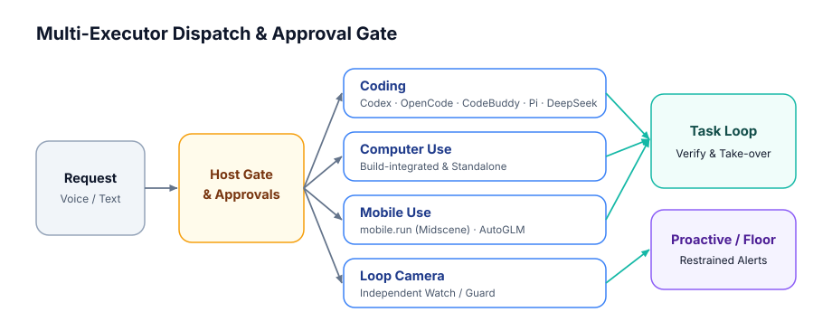

# Executors

Executors run background work while the foreground conversation continues. Nova owns task state, permissions and result delivery.

| Executor | Purpose | Status |
|---|---|---|
| [Coding](coding.md) | Write code, edit files and run commands in an approved project | Codex app-server & ACP agents (OpenCode, CodeBuddy, Pi, DeepSeek Harness) integrated |
| [Computer Use](computer-use-build.md) | Operate graphical interfaces under approval | Build-integrated & standalone computer executors |
| [Mobile Use](../../guides/mobile.md) | Run supervised phone automation (`mobile.run`) | Native TypeScript Midscene SDK (`autoglm-phone`) & legacy AutoGLM bridge |
| [Loop Camera](loop-camera.md) | Observe a selected camera and report when a condition is met | Native camera and independent vision model integrated |

<picture>
  <source media="(prefers-color-scheme: dark)" srcset="../../../assets/architecture/executor-dispatch.en.dark.svg">
  
</picture>

Loop Camera is the reader-facing feature name. Runtime uses the `vision` controller with internal `watch` / `guard` executors. It is separate from conversation vision, which captures one frame for a submitted turn.

Delegated work is now a durable Task: it is visible on the [Tasks](../tasks.md) page with a goal and acceptance criteria, is verified against that criteria before Nova marks it complete, and its control can be taken over by the user or handed back to Nova at any point.

New executors reuse dispatch, approval, progress, cancellation and result handoff. See [onboarding](../archs/10-executor-onboarding.md) and the [executor contract](../archs/05-executors.md). GUI-use plans are in the [roadmap](../archs/09-roadmap.md).
