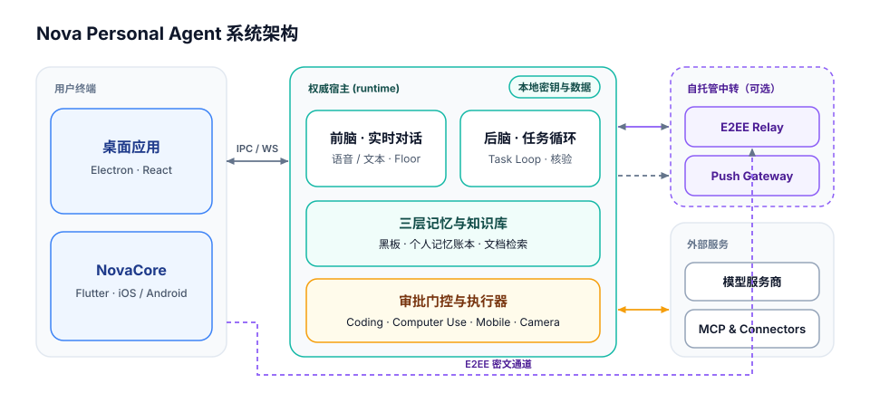

<a href="../en/README.md"><ins>English</ins></a> | <a href="README.md"><ins>简体中文</ins></a> · <a href="../../README.zh-CN.md">仓库首页</a>

**Nova Personal Agent（`v1.0.0`）使用与开发文档** — 双脑实时语音与文本交互、账本权威个人记忆、多执行器协同，以及桌面端与移动端（**NovaCore**）之间的端到端加密 Space 连接。

[上手指南](getting-started.md) · [工作原理](architecture.md) · [支持矩阵](support-matrix.md) · [安全与隐私](security.md) · [v1.0.0 版本说明](../releases/v1.0.0.md)

---

## 架构全景

<picture>
  <source media="(prefers-color-scheme: dark)" srcset="../../assets/architecture/system-overview.zh-CN.dark.svg">
  
</picture>

- **双脑协同运行时：** **前脑**保持实时语音与文本响应，**后脑**编排持久化任务循环、证据核验与随时接管/交还控制。
- **本地宿主权威：** 模型密钥、权限审批、信息源连接与个人记忆全部保留在本地 Host（`0700` 私密目录）；记忆内容永远不具备指令授权效力。
- **多执行器门控调度：** 在统一的宿主准入与审批门控下，调度代码执行（Codex + ACP）、桌面操作（Computer Use）、手机操作（`mobile.run`）与独立视觉监控（Loop Camera，仅运行时；v1.0 桌面应用暂不提供）。
- **端到端加密 Space 连接：** 通过 Tailscale Serve 自动配置或自托管零知识 `relay`，将 iOS 与 Android 客户端（**NovaCore**）安全配对到桌面或无头 Host。

---

## 文档导航

<table>
  <tr>
    <td width="50%" valign="top">
      <h3>1. 快速开始</h3>
      <ul>
        <li><a href="getting-started.md"><strong>上手指南</strong></a> — 安装、配置密钥与源码启动。</li>
        <li><a href="features.md"><strong>功能概览</strong></a> — 核心能力、使用边界与交互方式。</li>
        <li><a href="support-matrix.md"><strong>支持矩阵</strong></a> — 集成与级联语音管线、大模型、视觉与连接器。</li>
        <li><a href="../releases/v1.0.0.md"><strong>v1.0.0 版本说明</strong></a> — 新版亮点与 Space 升级说明（<a href="../releases/v0.4.0.md">v0.4.0</a>）。</li>
      </ul>
    </td>
    <td width="50%" valign="top">
      <h3>2. 工作台、任务与记忆</h3>
      <ul>
        <li><a href="workbench.md"><strong>Workbench</strong></a> — 时间线、想法、目标、资讯、任务与个人资料。</li>
        <li><a href="tasks.md"><strong>Tasks</strong></a> — 验收标准、证据核验、接管与交还控制。</li>
        <li><a href="sources-and-connectors.md"><strong>信息来源与连接器</strong></a> — 本地目录、Google、Apple 邮件/日历与飞书。</li>
        <li><a href="personal-memory.md"><strong>个人记忆</strong></a> — 统一账本、出处溯源、遗忘/清除与召回引擎。</li>
        <li><a href="knowledge-base.md"><strong>知识库</strong></a> — 按需开启的本地文档检索（FTS5 + 向量）。</li>
      </ul>
    </td>
  </tr>
  <tr>
    <td width="50%" valign="top">
      <h3>3. 移动端与 Space（iOS / Android）</h3>
      <ul>
        <li><a href="iphone.md"><strong>NovaCore 手机使用指南</strong></a> — iOS 与 Android 上的 Client 与独立 Space 模式。</li>
        <li><a href="space-host-client.md"><strong>Space / Host / Client 部署</strong></a> — 扫码配对、Tailscale 自动配置、无头 Host 与故障恢复。</li>
        <li><a href="deployment/remote-server.md"><strong>远程服务说明</strong></a> — 无头 Host 与 Relay 职责边界。</li>
        <li><a href="../../relay/README.md"><strong>自托管 Relay（英文）</strong></a> — Docker、TLS 与零知识密文转发。</li>
        <li><a href="../../push-gateway/README.md"><strong>推送网关（英文）</strong></a> — APNs 与 FCM 唤醒投递。</li>
      </ul>
    </td>
    <td width="50%" valign="top">
      <h3>4. 执行器与自动化</h3>
      <ul>
        <li><a href="executors/overview.md"><strong>执行器概览</strong></a> — 任务分发、资源租约与审批门控。</li>
        <li><a href="executors/coding.md"><strong>Coding 编程执行器</strong></a> — Codex app-server 与 ACP（OpenCode、CodeBuddy、Pi、DeepSeek Harness）。</li>
        <li><a href="executors/computer-use-build.md"><strong>Build 中的 Computer Use</strong></a> — macOS 与 Windows 受控桌面界面操作。</li>
        <li><a href="../guides/mobile.md"><strong>Mobile Use（<code>mobile.run</code>，英文）</strong></a> — 原生 TypeScript Midscene SDK（<a href="../guides/autoglm.md">旧版 AutoGLM</a>）。</li>
        <li><a href="executors/loop-camera.md"><strong>Loop Camera</strong></a> — 独立摄像头条件监控。</li>
      </ul>
    </td>
  </tr>
  <tr>
    <td width="50%" valign="top">
      <h3>5. 模型、语音与配置</h3>
      <ul>
        <li><a href="global-providers.md"><strong>OpenAI 与 Gemini 服务商</strong></a> — 海外实时与级联语音接入说明。</li>
        <li><a href="deployment/self-hosted-voice.md"><strong>自托管语音</strong></a> — 在自有 GPU 上运行 Whisper ASR、vLLM 与 Breeze TTS。</li>
        <li><a href="deployment/mac-local-voice.md"><strong>Mac 本地语音推理</strong></a> — 一条 Docker 命令在 Apple Silicon Mac 上跑起 ASR、LLM 与 TTS。</li>
        <li><a href="settings.md"><strong>桌面设置</strong></a> — 保存与重启生效边界及界面选项。</li>
        <li><a href="configuration.md"><strong>核心配置</strong></a> — 环境变量与能力注册表。</li>
      </ul>
    </td>
    <td width="50%" valign="top">
      <h3>6. 架构、协议与安全</h3>
      <ul>
        <li><a href="architecture.md"><strong>工作原理</strong></a> — 系统全景、任务循环与状态边界。</li>
        <li><a href="security.md"><strong>安全与隐私架构</strong></a> — E2EE 密钥边界、授权分离与执行器门控。</li>
        <li><a href="glossary.md"><strong>术语与不变量</strong></a> — 核心概念与系统约束。</li>
        <li><a href="protocols/client-v1.md"><strong>客户端协议 v1</strong></a> — 远端帧格式、音频规范与控制回执。</li>
        <li><a href="blog/2026-08-proactive-voice-agent-design-space.md"><strong>主动语音交互设计</strong></a> — 语音助手何时该开口、何时保持安静。</li>
      </ul>
    </td>
  </tr>
</table>

---

## 开发者架构参考系列

深入阅读 [`archs/`](archs/00-overview.md) 十一卷架构文档：

| 卷号 | 主题 | 核心内容 |
|---|---|---|
| 01 | [运行时主干](archs/01-spine.md) | 事件循环、双脑协调与语音归属 |
| 02 | [记忆](archs/02-memory.md) | L0 黑板、统一账本、派生召回引擎与知识库 |
| 03 | [上下文视图](archs/03-context-view.md) | 提示词组装、信任标签与有界投影 |
| 04 | [执行接口](archs/04-ports.md) | 模型、传输、记忆与工具端口契约 |
| 05 | [执行器](archs/05-executors.md) | 执行器生命周期、审批、进度与取消 |
| 06 | [本地开发](archs/06-verification.md) | Monorepo 构建、隔离测试与校验 |
| 07 | [设计约束](archs/07-decision-record.md) | 架构不变量与显式非目标 |
| 08 | [会话、模式与工作区](archs/08-conversations-modes-workspaces.md) | `Chat` / `Plan` / `Build` / `Delegate` 与语音单归属 |
| 09 | [路线图](archs/09-roadmap.md) | v1.0.0 之后的演进方向 |
| 10 | [执行器接入](archs/10-executor-onboarding.md) | 安全接入新执行器的标准流程 |
| 11 | [原生视觉与独立监控](archs/11-vision.md) | 对话视觉与独立 Loop Camera 监控的边界 |
