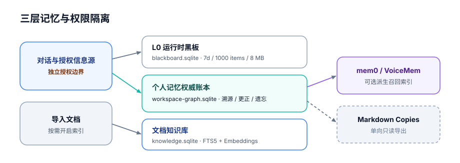

# 记忆

Nova 的记忆分为若干层，分别承担会话状态恢复、跨对话记忆和文档检索，数据来源与权限边界各不相同。

## 分层

<picture>
  <source media="(prefers-color-scheme: dark)" srcset="../../../assets/architecture/memory-layers.zh-CN.dark.svg">
  
</picture>

- **L0——会话运行状态。** `Memory` 频道、已分派的执行任务、已接受的交接，以及绑定当前需求修订号的收集状态，共同构成会话的当前状态，以运行时状态为准。宿主的授权与项目确认状态机属于宿主自身的状态，模型不能把它们当作可写的规划状态。黑板条目会记录时间、信任级别、优先级、结果和证据引用，状态按事件顺序更新，响应只能基于已生效的事件。当前任务和执行器状态只能由运行时更新。
- **个人记忆。** 本地统一账本默认开启；也可显式选择 mem0、宿主管控的远程连接或关闭记忆。先保存来源，再异步提取其中的事实，让有用信息跨对话保留。检索、由宿主发起的删除和可选的查看功能都不依赖实时任务状态。配置方式、模型数据流向以及当前桌面视图的限制见[个人记忆](../personal-memory.md)。

## 会话恢复存储

L0 黑板由专用 SQLite Worker 持久化（`runtime/src/memory/blackboard-session.ts`、`blackboard-store.ts`、`blackboard-worker.ts`），因此对话能跨重启保留。保留量受三个彼此独立的限制约束：条目存活 7 天、最多 1000 条、最多 8MB，超限时先丢弃最旧的条目。数据库路径由 `BLACKBOARD_PATH` 指定（默认 `~/.nova-audio-agent/blackboard.sqlite`），并按 `BLACKBOARD_OWNER_ID` 区分归属。

该存储只负责恢复会话历史，不是可查询的长期记忆，不受限制的长期记忆检索仍被推迟（[设计约束](07-decision-record.md)）。

## 个人记忆引擎

个人记忆通过统一接口接入（`runtime/src/memory/personal-memory.ts`）。`MEMORY_CONNECTION` 选择本地、远程或关闭。
显式本地组合使用 `MEMORY_RECALL_ENGINE=ledger` 与 `MEMORY_EXTRACTORS=ledger`；两者留空时保留默认账本及旧数据迁移。
`MEMORY_PROVIDER` 已弃用：`voicemem` 保留该迁移，`mem0` 保留独立模式，不能与新变量共用。
`MEMORY_RECALL_ENGINE=voicemem|mem0` 已通过真实 SDK 接入，账本仍是版本、证据与同意的权威。关闭记忆不会分配个人存储。

**mem0（显式选择的替代引擎）** 会先把来源写入自身账本，再让模型看到它们。每个来源在 `pending → learned` 之间流转，被删除时变为 `forgotten`；`recall()` 只返回 `learned` 的来源，并在异步抽取调用之后再次检查状态，避免在用户同时删除记忆时返回已经失效的内容。待学习记录在后台异步处理，通过互斥锁保证只有一个进程执行抽取（`learning-lock.db`，`PRAGMA busy_timeout=0`），第二个进程会快速失败，而不会重复同样的工作。同一来源重复提交不会重复入库。存储按用户隔离：`memory.sqlite.mem0/<sha256(userId)>/`，其中 `ledger.db` 与 mem0 SDK 自带的向量数据库放在一起。

**统一本地账本（默认）** 由生产组装接入 `runtime/src/memory-substrate/`，保存来源原文、修订历史与处理同意，并提供统一检索。旧 VoiceMem 数据可只读迁入，原数据库保留。`voicemem` 名称继续用于配置兼容；兼容层保留注入旧本地工厂的行为。**远程个人记忆**（`remote-personal-memory.ts`）是宿主管控的 HTTP 客户端，对接 `/v1/remember`、`/v1/forget`、`/v1/recall` 和 `/v1/preferences`；URL 必须是 HTTPS 或回环地址，响应体有大小上限。

旧独立 mem0 和远程记忆不迁移统一账本；新的 `MEMORY_RECALL_ENGINE=mem0|voicemem` 会从现有账本回填 SDK 派生索引。旧 VoiceMem 的只读迁入是独立路径。

`MEMORY_EXTRACTORS=ledger,voicemem` 可选开启情绪/特质抽取，仅保存在 SDK 中，不写账本事实。特质至少需要三个不同且仍获授权的用户会话来源；背景从最早证据起最多保留十分钟，每次使用前重新校验。纠正、删除、撤回同意与清除通过事务代际 outbox 驱动幂等 SDK 对账，带租约、外部写锁和重启重试。引擎结果始终重新解析为账本 ID、版本和来源；项目/general 内容可显式读取并携带权威 scope 标签，但不进入自动用户背景召回。复用现有 embedding 与 fast 模型路由，无新增记忆专属密钥。同意校验、有效期与持久重试机制见[个人记忆](../personal-memory.md)。

## 独立的文档知识（K）

可选开启的知识语料与实时对话、个人记忆相互独立。SQLite Worker 存放用户主动提交的文档、分块和向量；关键词检索与向量余弦相似度的排名通过倒数排名融合（RRF）合并。词法检索在支持时使用 FTS5，否则退化为有界参数化 LIKE（Node 22.13 也走这条路径）；条件允许时，打开数据库会依据数据库中的原始分块重建 FTS。

入库和重建索引只能由宿主发起，并且需要用户在设置面板中同意数据外发。文本会发往配置好的 向量模型服务；数据保存在本地，不代表推理也在本地。

FrontBrain 只能看到 `mcp__nova_knowledge__recall`。可选的身份认证回环 MCP 会为 Codex 额外提供 `get_chunk`；工单引用由宿主附加、有长度上限，并会重新校验。公开结果会隐去私有来源路径，并始终为 `untrusted_external`。关闭该模块后不会分配 Worker 或 MCP 服务器，也不影响 `memory__recall`。ContextView 不会自动注入语料内容。详见[知识库指南](../knowledge-base.md)。

敏感路径和内容检查位于 `runtime/src/memory/sensitivity.ts`，由知识模块、个人记忆入库和执行器引用处理共用，因此任何路径上疑似凭据的内容都会在入库或发送给模型服务之前被拒绝。
